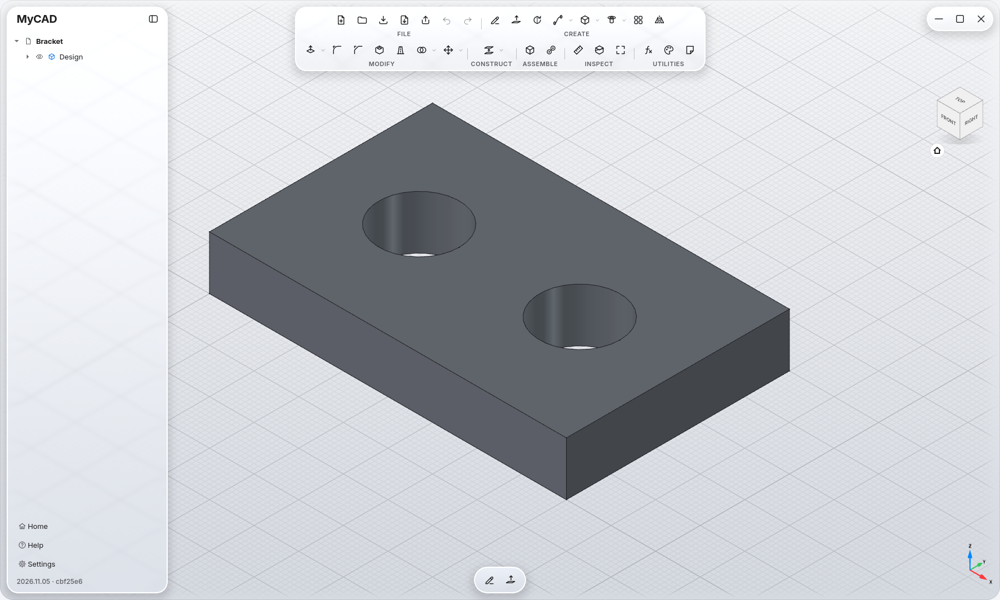
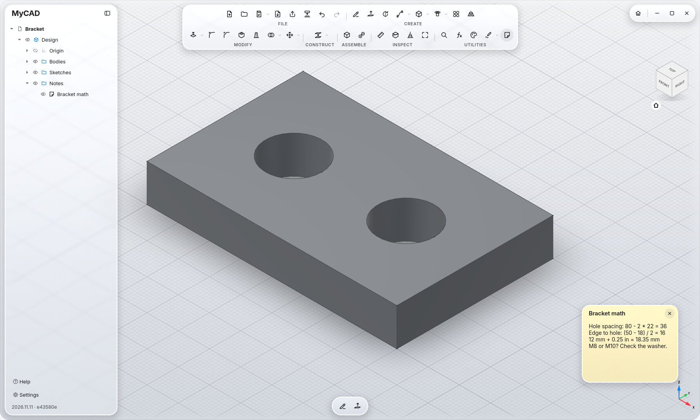
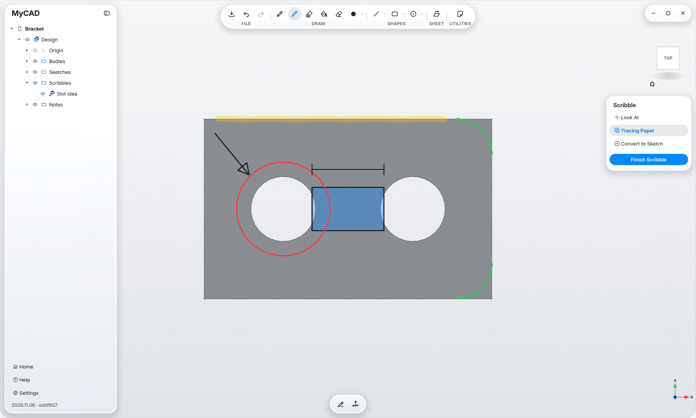
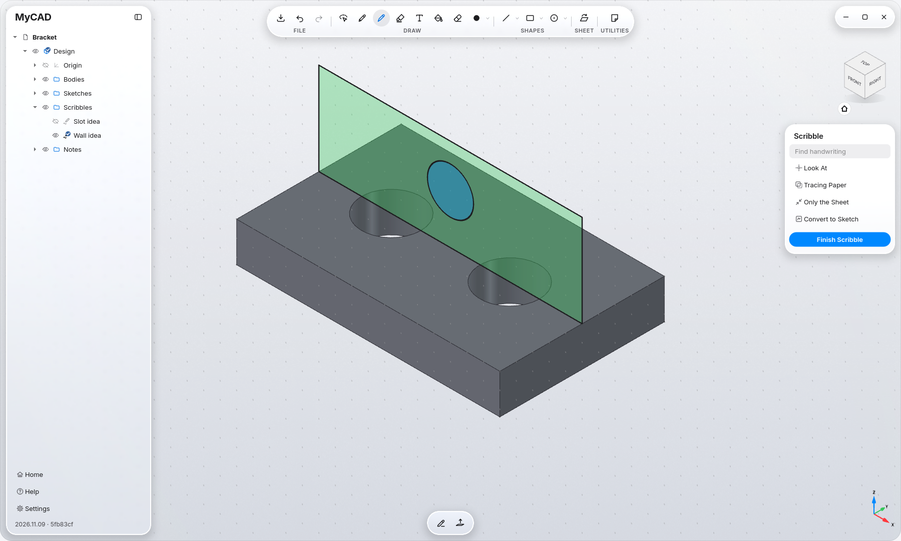
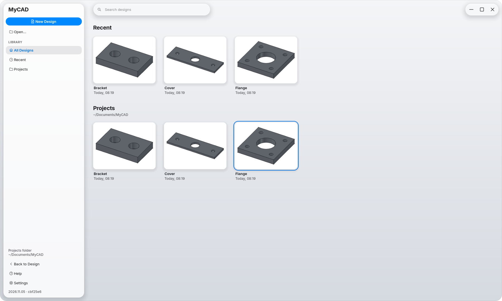
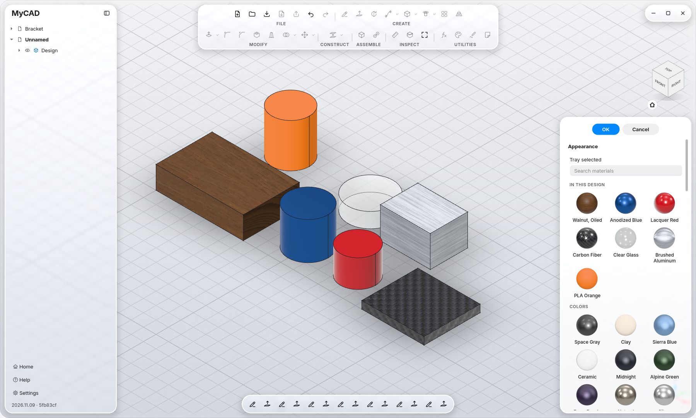

<div align="center">

# MyCAD

### Pro CAD. Featherlight.

Sketch. Extrude. Done.<br>
The workflow of Fusion 360 with the look of Liquid Glass. Built for Linux.

<br>



</div>

<br>

## Liquid Glass. Down to the last pixel.

Every surface in MyCAD is made of glass. The toolbar, browser, window buttons and inspector float above your model, so you can still see the model behind them. A custom GPU shader blurs the background, bends it at the edges like a real lens, and adds a thin highlight and a soft shadow. It all runs in real time while you orbit.

The **Liquid Glass** slider in Settings works like the one in iOS 27: slide it from **Ultra Clear** to see more of your design through the glass, or towards **Tinted** for a denser, easier-to-read glass. **Default** sits in the middle.

MyCAD comes in **Light** and **Dark**. **Automatic** follows your desktop. Dark mode is made for modeling: a calm dark-gray background instead of black, white lines for fully constrained sketches, and a subtle grid. Increase Contrast, Reduce Transparency and Reduce Motion are built in.

Messages show up as floating glass alerts with no window frame and capsule-shaped buttons. Corners are rounded concentrically and icons are monochrome.

<br>

## Sketch the way you think.

Pick a plane and start drawing: line, polyline, rectangle, circle, arc, slot, polygon, B-spline, conic, point and text. You can project edges from your model straight into the sketch.

Fillet, trim, extend, split, offset, mirror, pattern, move and scale are all one click away. A single dimension tool works out from your selection what you want to measure. The available constraints are coincident, horizontal, vertical, parallel, perpendicular, tangent, equal, symmetric and fix.

**Esc** puts the active tool away, and **Finish Sketch** takes you back to your model.

<br>

## Click. And it's a solid.

Every closed region in a sketch is its own profile. Draw two circles inside each other, click the ring between them, and **Extrude** turns it into a tube, the same way it works in Fusion.

**Create:** Extrude · Revolve · Sweep · Loft · Rib · Web · Emboss · Box · Cylinder · Sphere · Torus · Coil · Hole · Thread · Pattern · Mirror

**Modify:** Press Pull · Replace Face · Split Face · Fillet · Chamfer · Shell · Draft · Combine · Split Body · Move · Align · Scale

**Construct:** Offset Plane · Plane at Angle · Midplane · Plane · Axis · Point

**Inspect:** Measure · Section Analysis

Every step goes into the **Timeline**. Go back, change a dimension, and the rest of the design follows. With **Change Parameters** you can drive the whole model from named values and formulas.

<br>

## Parts that fit together.

Create **components** and connect them with **joints**. Each component has its own bodies, sketches and origin, and all of it lives in a single design file.

<br>

## Notes that stay put.

<div align="center">



</div>

Click **Note** in the toolbar and a yellow note lands on top of your model. Drag it wherever you want it. It sticks to that corner of the window and stays open while you go in and out of sketches.

It can do the math too. End a line with `=` and the answer appears right after it: type `120 / 4 =` and you get `30`. Units work (`10 mm + 1 in =` gives `35.40 mm`), and so do the names from **Change Parameters**.

Closed a note? It's still under **Notes** in the browser, double-click to open it again. Notes are saved in the design file, so they're still there next time you open it.

<br>

## Ideas first. Scribble.

<div align="center">



</div>

Click **Scribble** in the toolbar and a sheet of paper with a fine dot grid fills the view. It takes on MyCAD's own light or dark background, and in dark mode your inks get lighter so blue and yellow stay easy to read. Grab your pen tablet and draw with **Pencil**, **Fineliner** or **Marker** in five colors. Press harder and the line gets thicker. Flip the pen over to erase. No eraser on your pen? Press **E**, and **E** again takes you back to the pen.

Hold the pen still at the end of a stroke and it straightens into a clean line, circle or rectangle. Lines snap to horizontal, vertical and to the ends of your other strokes.

Messy handwriting? Just write. A second after you lift the pen, your words glide into place: straight lines, the same size, slant and spacing, still in your own hand. Ctrl+Z brings back the raw version, and **Pen & Handwriting** in Settings makes the tidy-up gentler or turns it off.

MyCAD also reads what you write, offline, with a small model for German handwriting. Sizes come out the CAD way right in your ink: o12 gets its slash and becomes Ø12, 2x45 gets its degree sign, 25mm becomes 25 mm. **Find handwriting** in the palette jumps to any note on the sheet, and **Convert to Sketch** turns an Ø12 written next to a circle into that circle's dimension.

Under **Shapes** you drag out a line, arrow, rectangle, triangle, hexagon, circle or ellipse. **Fill** colors an area: tap inside a shape, or draw around the part you want filled.

To move things around, hold the pen still on a stroke for a moment and it sticks to the pen. **Select** picks up more at once (with the mouse too): tap a stroke or draw around a few, then drag. A small bar under the selection recolors them or deletes them.

No pen tablet at hand? **Text** writes with the keyboard: click on the sheet and type, Enter puts it down. Each line becomes a stroke you can select, move and recolor.

**Tracing Paper** lets the model show through, so you can draw right on top of a part. **Only the Sheet** (Tab) folds the toolbar, browser and palette into a small pill at the top, so it's just you and the paper.

<div align="center">



</div>

Then go 3D. **Move Sheet** lays the paper onto any face of your model, or stands it up along a line you drew, so you can sketch a wall or a rib right where it goes. Orbit around it and the paper fades, so you see your strokes and the model together.

Happy with an idea? **Convert to Sketch** turns your lines, circles, ellipses and other shapes into a real sketch, joined up and ready to dimension and extrude. Your scribbles stay in the design under **Scribbles** in the browser.

<br>

## Everything at a glance.

<div align="center">



</div>

The start page lists your recent designs and everything in your project folder, each with a large preview. Type a few letters into the search box to find a part, then click it to pick up where you left off. **Home** in the sidebar brings you back here at any time.

<br>

## Your hands. Your rules.

Choose from twelve navigation styles, including **Fusion 360**, **SolidWorks**, **Blender**, **Siemens NX** and **Touchpad**. MyCAD shows you which key or gesture orbits, pans, zooms and selects in the style you picked.

You can map a key to a mouse button, for example **Shift** as the middle button, and then navigate with your touchpad. Shift still works as Shift when you type. MyCAD orbits around the body under your cursor. If you'd rather see names than icons, turn on **Show tool names**.

Pen tablets work on Wayland with pressure and hover. The side buttons orbit and pan, even while the tip is on the paper. In KDE's **Drawing Tablet** settings you can give the buttons on your tablet keys: **E** for the eraser, **V** to select, **L** to look straight at the sheet, Ctrl+Z to undo. With **E** on a button, you can erase in one press even with a pen that has no eraser end, like the Huion Inspiroy H640P's.

<br>

## Speaks your language.

Switch to **Deutsch** in the settings and MyCAD is in German, from the toolbar down to the error messages. The terms are the ones you know from the German version of Fusion 360 (Extrudieren, Drehen, Abrunden, Bohrung, Gelenk), and new sketches and bodies are called Skizze1 and Körper1.

<br>

## Materials with character.

<div align="center">



</div>

Bodies stand in a gray room with bright light panels, much like a photo studio. Metal mirrors the panels, red lacquer shines under its clear coat, and glass stays see-through but still reflects. New bodies come in **Space Gray**. Pick another default in the settings and your existing bodies switch right away.

**Appearance** has 119 materials: raw and polished metals, anodized aluminum in nine colors, powder coat, lacquer and metallic paint, matte, satin and glossy plastics, PLA that shows its print layers up close, rubber and silicone, glass and acrylic, woods raw, oiled or lacquered, stone and ceramics, leather, felt and carbon. Each one is a small sphere drawn the same way as your model, with its colors and finishes as dots underneath. Search by name, right-click to keep a favorite, and see at the top what this design already uses. Click a sphere to apply it to the selected bodies, or drag it straight onto a body. With single faces selected, only those faces change color.

The woods, stone, leather, cork, fabric, carbon and brushed metals are real photo scans with their relief, and a wooden part shows end grain where it's cut. A soft shadow grounds every body on the grid. Under **Materials and Light** in the settings you can switch each of these off on its own: realistic materials, reflections, relief and end grain, and the contact shadow. Turn off what gets in your way, or what your graphics card can't keep up with.

<br>

## Speaks STEP. And STL. And DXF.

**Export** to STL or 3MF for your 3D printer, or to STEP for any other CAD program. Sketches export as DXF, for example for laser cutters or CNC mills. **Import** STEP models, and bring DXF and SVG drawings straight into a sketch.

<br>

## Tech specs

| | |
|---|---|
| **Platform** | Linux, developed and tested on CachyOS with KDE Plasma (Wayland) |
| **Interface** | Liquid Glass with a GPU glass shader, light and dark mode, English or German |
| **Model** | Parametric, with a global timeline, components and joints |
| **Sketch** | 12 drawing tools, 7 modify tools, 9 constraints, one dimension tool |
| **Solids** | 16 create, 12 modify and 6 construction tools |
| **Notes** | Saved in the design, lines ending in `=` are calculated |
| **Scribbles** | Pen tablet with pressure, 7 shapes, fill, text, select and move with a color and delete bar, sheets in 3D, convert to sketch, handwriting tidy-up, offline handwriting recognition (find, CAD notation, written dimensions), Only the Sheet mode |
| **Export** | STL · 3MF · STEP · DXF (sketches) |
| **Import** | STEP · DXF · SVG |
| **File format** | `.mycad` (ZIP with preview image, same content as FreeCAD's FCStd); `.FCStd` files open too |
| **Navigation** | 12 styles, keys as mouse buttons, orbit around the body under the cursor |
| **Pen tablet** | Pressure and hover on Wayland, side buttons navigate, keys for tablet buttons (E eraser, V select, L look at) |
| **Materials** | 119 in 12 groups (metal, anodized, coatings, plastic, 3D print, rubber, glass, wood, stone, fabric and leather, composites, Apple colors), 19 CC0 photo scans with relief, reflections of a room, clear coat, end grain, contact shadow |
| **Core** | FreeCAD with OpenCascade |
| **License** | LGPL-2.1-or-later |

<br>

## Download. Run. Done.

The latest version is always on the [**Releases**](https://github.com/HanreichC/MyCAD/releases/latest) page as an AppImage, rebuilt after every commit. There's nothing to install and no container to set up, just one file:

```sh
chmod +x MyCAD-*-x86_64.AppImage
./MyCAD-*-x86_64.AppImage
```

The AppImage is built for current Arch-based systems such as CachyOS.

<br>

## Or build it yourself. In two commands.

```sh
./install.sh   # builds MyCAD in a Podman container and adds the `mycad` launcher and a menu entry
mycad          # starts MyCAD
```

The build runs inside a Podman container (`.devcontainer/`), so the compiler and dependencies stay off your system. Running it again only rebuilds what changed. `JOBS=8 ./install.sh` sets how many cores to use (the default is 6, at lowest priority).

**You need** Linux with Wayland, Podman, and a GPU with OpenGL.

<br>

## For developers.

The core of the interface lives in [`src/Gui/Shell/`](src/Gui/Shell) and the Fusion-style tools in [`src/Mod/Design/`](src/Mod/Design). [`tools/make_icons.py`](tools/make_icons.py) generates the icons. [`tools/fetch_textures.py`](tools/fetch_textures.py) downloads the photo scans for the materials, and [`tools/make_environment.py`](tools/make_environment.py) renders the room that metal and lacquer reflect. [`tests/gui/test_materials.py`](tests/gui/test_materials.py) checks reflections, end grain and the contact shadow.

The GUI tests click through the app like a person would, with real mouse and keyboard events:

```sh
tests/gui/run.sh tests/gui/test_ring.py /tmp/ring   # log in /tmp/ring.txt, screenshot in /tmp/ring.png
```

The scribble math runs without FreeCAD. [`tests/scribble_tidy_check.cpp`](tests/scribble_tidy_check.cpp) checks the handwriting tidy-up, [`tests/scribble_read_check.cpp`](tests/scribble_read_check.cpp) reads synthetic handwriting with the real model, and [`tests/gui/test_handwriting.py`](tests/gui/test_handwriting.py) writes with the mouse and a simulated pen tablet in the running app.

The roadmap is in [`docs/PLAN.md`](docs/PLAN.md).

<br>

## Origins and license.

MyCAD is built on [FreeCAD](https://www.freecad.org), the free parametric CAD program. Thanks to everyone who works on it. [`docs/UPSTREAM.md`](docs/UPSTREAM.md) has the details.

Like FreeCAD, MyCAD is licensed under the [LGPL-2.1-or-later](LICENSE).

The material scans come from [Poly Haven](https://polyhaven.com) and [ambientCG](https://ambientcg.com), both CC0. [`src/Gui/Shell/textures/SOURCES.md`](src/Gui/Shell/textures/SOURCES.md) lists each one.

Handwriting recognition uses [DE·HTR v2](https://huggingface.co/naeyn/de-htr-web-v2) (Apache-2.0), trained on the ScaDS.AI German handwriting dataset (CC BY 4.0, Universität Leipzig) and fhswf/german_handwriting (AFL-3.0). Details in [`src/Mod/Design/Gui/htr/`](src/Mod/Design/Gui/htr/README.md).

<sub>MyCAD is an independent project and is not affiliated with Apple Inc. or Autodesk, Inc. Liquid Glass is a design language by Apple, and Fusion 360 is a trademark of Autodesk. Both names are used here only to describe the style and workflow.</sub>
