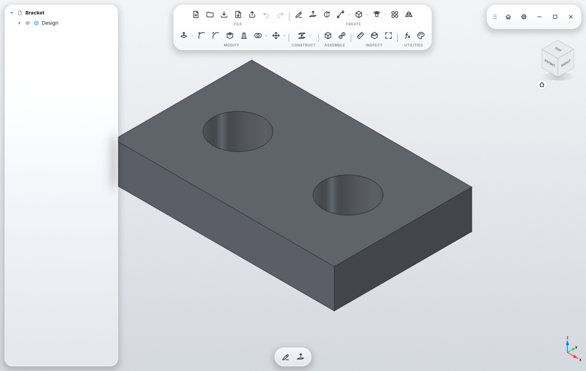
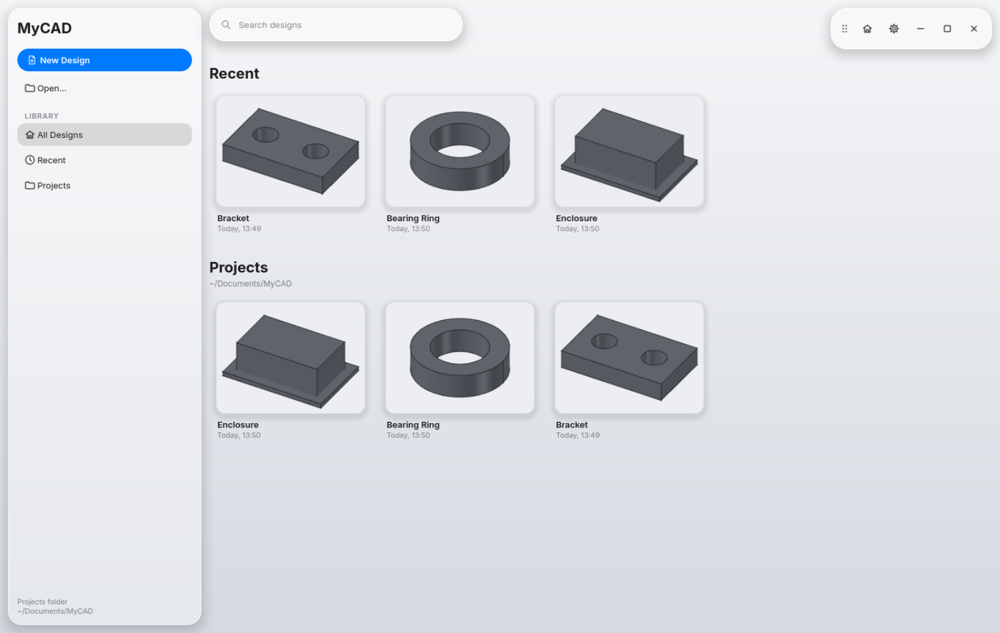

<div align="center">

# MyCAD

### Pro CAD. Featherlight.

Sketch. Extrude. Done.<br>
The workflow of Fusion 360 with the look of Liquid Glass. Built for Linux.

<br>



</div>

<br>

## Liquid Glass. Down to the last pixel.

Every surface in MyCAD is made of glass. The toolbar, browser, window buttons and inspector float above your model, so you can still see the model behind them. A custom GPU shader blurs the background, bends it at the edges like a real lens, and adds a thin highlight and a soft shadow. It all runs in real time while you orbit.

If you want to see more of your design through the glass, switch to **Glass: Clear**. **Tinted** gives the glass a stronger tint.

Messages show up as floating glass alerts with no window frame and capsule-shaped buttons. Corners are rounded concentrically and icons are monochrome. The interface stays light even on a dark desktop.

<br>

## Sketch the way you think.

Pick a plane and start drawing: line, polyline, rectangle, circle, arc, slot, polygon, B-spline, conic, point and text. You can project edges from your model straight into the sketch.

Fillet, trim, extend, split, offset, mirror, pattern, move and scale are all one click away. A single dimension tool works out from your selection what you want to measure. The available constraints are coincident, horizontal, vertical, parallel, perpendicular, tangent, equal, symmetric and fix.

**Esc** puts the active tool away, and **Finish Sketch** takes you back to your model.

<br>

## Click. And it's a solid.

Every closed region in a sketch is its own profile. Draw two circles inside each other, click the ring between them, and **Extrude** turns it into a tube, the same way it works in Fusion.

**Create:** Extrude · Revolve · Sweep · Loft · Rib · Web · Emboss · Box · Cylinder · Sphere · Torus · Coil · Hole · Thread · Pattern · Mirror

**Modify:** Press Pull · Replace Face · Split Face · Fillet · Chamfer · Shell · Draft · Combine · Split Body · Move · Align · Scale

**Construct:** Offset Plane · Plane at Angle · Midplane · Plane · Axis · Point

**Inspect:** Measure · Section Analysis

Every step goes into the **Timeline**. Go back, change a dimension, and the rest of the design follows. With **Change Parameters** you can drive the whole model from named values and formulas.

<br>

## Parts that fit together.

Create **components** and connect them with **joints**. Each component has its own bodies, sketches and origin, and all of it lives in a single design file.

<br>

## Everything at a glance.

<div align="center">



</div>

The start page lists your recent designs and everything in your project folder, each with a large preview. Type a few letters into the search box to find a part, then click it to pick up where you left off. The Home button brings you back here at any time.

<br>

## Your hands. Your rules.

Choose from twelve navigation styles, including **Fusion 360**, **SolidWorks**, **Blender**, **Siemens NX** and **Touchpad**. MyCAD shows you which key or gesture orbits, pans, zooms and selects in the style you picked.

You can map a key to a mouse button, for example **Shift** as the middle button, and then navigate with your touchpad. Shift still works as Shift when you type. MyCAD orbits around the body under your cursor. If you'd rather see names than icons, turn on **Show tool names**.

<br>

## Speaks your language.

Switch to **Deutsch** in the settings and MyCAD is in German, from the toolbar down to the error messages. The terms are the ones you know from the German version of Fusion 360 (Extrudieren, Drehen, Abrunden, Bohrung, Gelenk), and new sketches and bodies are called Skizze1 and Körper1.

<br>

## Materials with character.

New bodies come in **Space Gray** with a satin finish. You can pick **Clay**, **Sierra Blue** or **Ceramic** in the settings instead, and existing bodies switch right away. **Appearance** gives a single body its own color.

<br>

## Speaks STEP. And STL. And DXF.

**Export** to STL or 3MF for your 3D printer, or to STEP for any other CAD program. Sketches export as DXF, for example for laser cutters or CNC mills. **Import** STEP models, and bring DXF and SVG drawings straight into a sketch.

<br>

## Tech specs

| | |
|---|---|
| **Platform** | Linux, developed and tested on CachyOS with KDE Plasma (Wayland) |
| **Interface** | Liquid Glass with a GPU glass shader, light theme, English or German |
| **Model** | Parametric, with a global timeline, components and joints |
| **Sketch** | 12 drawing tools, 7 modify tools, 9 constraints, one dimension tool |
| **Solids** | 16 create, 12 modify and 6 construction tools |
| **Export** | STL · 3MF · STEP · DXF (sketches) |
| **Import** | STEP · DXF · SVG |
| **File format** | FCStd (ZIP with preview image) |
| **Navigation** | 12 styles, keys as mouse buttons, orbit around the body under the cursor |
| **Materials** | Space Gray · Clay · Sierra Blue · Ceramic |
| **Core** | FreeCAD with OpenCascade |
| **License** | LGPL-2.1-or-later |

<br>

## Download. Run. Done.

The latest version is always on the [**Releases**](https://github.com/HanreichC/MyCAD/releases/latest) page as an AppImage, rebuilt after every commit. There's nothing to install and no container to set up, just one file:

```sh
chmod +x MyCAD-*-x86_64.AppImage
./MyCAD-*-x86_64.AppImage
```

The AppImage is built for current Arch-based systems such as CachyOS.

<br>

## Or build it yourself. In two commands.

```sh
./install.sh   # builds MyCAD in a Podman container and adds the `mycad` launcher and a menu entry
mycad          # starts MyCAD
```

The build runs inside a Podman container (`.devcontainer/`), so the compiler and dependencies stay off your system. Running it again only rebuilds what changed. `JOBS=8 ./install.sh` sets how many cores to use (the default is 6, at lowest priority).

**You need** Linux with Wayland, Podman, and a GPU with OpenGL.

<br>

## For developers.

The core of the interface lives in [`src/Gui/Shell/`](src/Gui/Shell) and the Fusion-style tools in [`src/Mod/Design/`](src/Mod/Design). [`tools/make_icons.py`](tools/make_icons.py) generates the icons.

The GUI tests click through the app like a person would, with real mouse and keyboard events:

```sh
tests/gui/run.sh tests/gui/test_ring.py /tmp/ring   # log in /tmp/ring.txt, screenshot in /tmp/ring.png
```

The roadmap is in [`docs/PLAN.md`](docs/PLAN.md).

<br>

## Origins and license.

MyCAD is built on [FreeCAD](https://www.freecad.org), the free parametric CAD program. Thanks to everyone who works on it. [`docs/UPSTREAM.md`](docs/UPSTREAM.md) has the details.

Like FreeCAD, MyCAD is licensed under the [LGPL-2.1-or-later](LICENSE).

<sub>MyCAD is an independent project and is not affiliated with Apple Inc. or Autodesk, Inc. Liquid Glass is a design language by Apple, and Fusion 360 is a trademark of Autodesk. Both names are used here only to describe the style and workflow.</sub>
