<div align="center">

# MyCAD

### Fusion-style CAD. Native on Linux.

Local. No subscription. Made for 3D printing.<br>
Sketch, extrude, print: the workflow you know from Fusion 360, with the look of Liquid Glass.

<br>

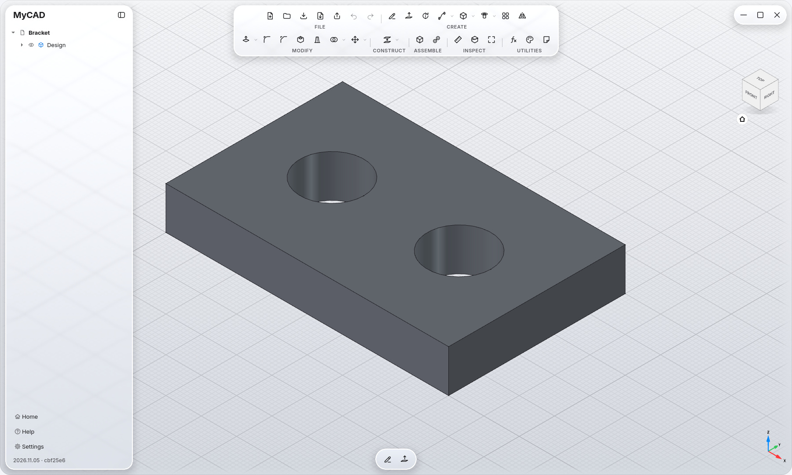

**[Wiki](https://github.com/HanreichC/MyCAD/wiki)** · [Everything MyCAD can do](https://github.com/HanreichC/MyCAD/wiki/Features) · [Tutorial](https://github.com/HanreichC/MyCAD/wiki/Tutorial-3D-Printed-Bracket) · [Download](https://github.com/HanreichC/MyCAD/releases/latest)

</div>

<br>

## Why MyCAD.

- **Runs on Linux, for real.** Not in a virtual machine, not in a browser tab. Wayland, your GPU, pen tablets, touchpad gestures and the SpaceMouse (via spacenavd), all native.
- **Your files stay yours.** Designs live in a folder on your disk. MyCAD saves after every step and keeps versions the way Time Machine keeps backups. No cloud, no account, no subscription, and no limit on how many designs you can edit.
- **Made for 3D printing.** Print View shows overhangs and thin walls and fixes them in a click. Fits know the play a printed part needs, threads print, **Screw Here** adds the holes for screws and heat-set inserts, and **Print** hands the part to your slicer.
- **It helps instead of blaming.** A fillet too big? MyCAD offers the largest one that works. About to delete something other steps need? It tells you first. Double-click a face to change the number behind it.
- **Works like Fusion 360.** Sketches with profiles, a global timeline, components and joints, the same tool names. If you know Fusion, you already know your way around.

<br>

## Sketch the way you think.

Pick a plane and start drawing: line, polyline, rectangle, circle, arc, slot, polygon, B-spline, conic, point and text. You can project edges from your model straight into the sketch.

Fillet, trim, extend, split, offset, mirror, pattern, move and scale are all one click away. A single dimension tool works out from your selection what you want to measure. Place the dimension and type the value right on it, no window in the way; **Tab** applies it and jumps to the next dimension, so you size a whole sketch without touching the mouse. The Sketch Palette tells you how many dimensions are still missing, and one click adds them the way you most likely mean: symmetric when the shape sits centered on the origin, right angles and equal sides where the shape has them (even when it is drawn at a slant), then the sizes, then where it sits. The available constraints are coincident, horizontal, vertical, parallel, perpendicular, tangent, equal, symmetric and fix.

Got a pen tablet? Draw straight into the sketch. Hold the pen still at the end and the stroke becomes a clean line, circle or rectangle; otherwise it follows your hand. Scratch over lines to delete them, and a tick finishes the sketch.

**Esc** puts the active tool away, and **Finish Sketch** takes you back to your model.

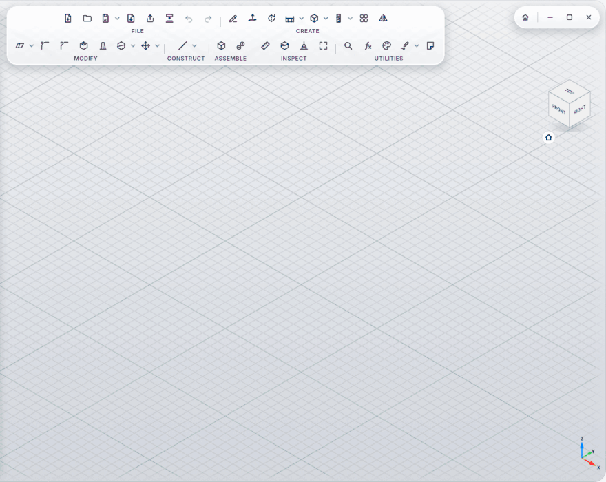

<br>

## Click. And it's a solid.

Every closed region in a sketch is its own profile. Draw two circles inside each other, click the ring between them, and **Extrude** turns it into a tube, the same way it works in Fusion.

**Create:** Extrude · Revolve · Sweep · Loft · Rib · Web · Emboss · Box · Cylinder · Sphere · Torus · Coil · Hole · Screw Here · Thread · Pattern · Mirror

**Modify:** Press Pull · Fit · Remove Face · Replace Face · Split Face · Fillet · Chamfer · Shell · Draft · Combine · Split Body · Move · Align · Scale

**Construct:** Offset Plane · Plane at Angle · Midplane · Plane · Axis · Point

**Inspect:** Measure · Section Analysis · Print View

The toolbar is one calm row with the tools you use most: Sketch, Extrude, Hole, Press Pull, Fillet, Measure. Click a heading such as **CREATE ▾** and every tool of the group opens in a glass grid with its name. **PRINT** gathers everything for the printer: Print View, the bottom face, fits, export and your slicer. Prefer every tool at once? Settings › Toolbar › All Tools.

And you rarely need the toolbar for the next step. Click a face, an edge or a profile, and the tools that fit float right above it: Press Pull, Sketch, Hole and Shell on a flat face, Fillet and Chamfer on an edge, Extrude and Revolve on a profile, Move, Mirror and Pattern on a whole body. The magnifier at the end opens every command.

**Photo to Sketch** (Import a photo) traces a flat part photographed on plain paper into a sketch to scale (outline and holes, round ones as real circles). Lay it on an A4 sheet and the photo may even be taken at an angle: MyCAD straightens it and needs no input. On grid paper it finds the squares and only asks their size; on plain paper you type the real width. Extrude, done. Handy for spare parts.

A cut goes through everything in its way, even bodies of other components. Extrude one side, symmetric, two sides, up to an object or through all, with a taper and as a thin wall. Click a face to drill a hole: it snaps to the middle or to the centre of a round face and is dimensioned to the two nearest edges by itself. Keep clicking for more holes; one at the same edge distance joins the row and moves with it. Holes follow ISO metric, metric fine, UNC and UNF, as clearance or tapped holes with the counterbore or countersink of the right screw. Threads are real and printable. Fillets can vary along an edge, patterns can follow a path, and mirror, pattern and move work with any plane, face, edge or axis.

Every step goes into the **Timeline**. Go back, change a dimension, and the rest of the design follows. Drag steps into a new order, and group them into chips you can fold away. Hover a step and everything that depends on it lights up; delete something others rely on and MyCAD tells you first what goes along, instead of you finding out later. With **Change Parameters** you can drive the whole model from named values and formulas. **Check References** lists every step that no longer finds its edges or faces for certain, with a button to show, re-pick or confirm each.

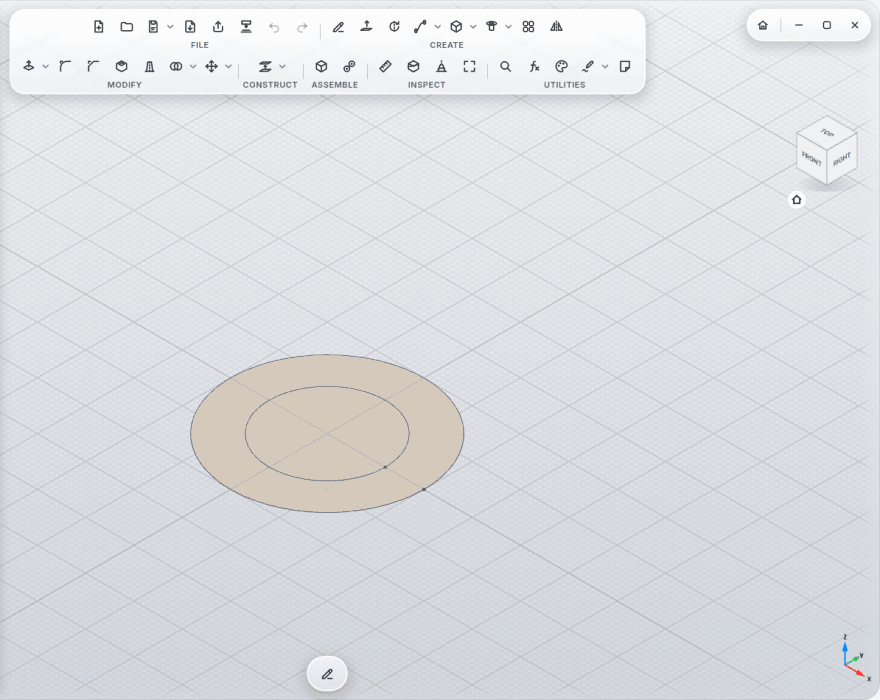

<br>

## Made for makers.

**Print View** shows on the model what your printer will struggle with: overhangs hatched red, faces on the bed dotted green, walls that are too thin cross-hatched yellow. Under **Make printable** it offers the fix, one click each: a sideways hole becomes a teardrop that needs no supports, a fillet chamfers its bottom edges at 45°, a thin wall grows to the minimum. Pick the face that should lie on the bed, or let **Suggest Orientation** find the lay with the least support and the lowest height that fits your print bed (a part that is too big says so in red, and **Split** cuts it into as many equal pieces as needed, with pins that plug them together again), then hit **Print**: MyCAD finds **OrcaSlicer**, **Bambu Studio**, **PrusaSlicer** or **UltiMaker Cura**, installed as a program, a **Flatpak** or an AppImage, and opens your design there as a colored 3MF, right side down. Faces you colored on their own keep their color, ready for a multi-color print.

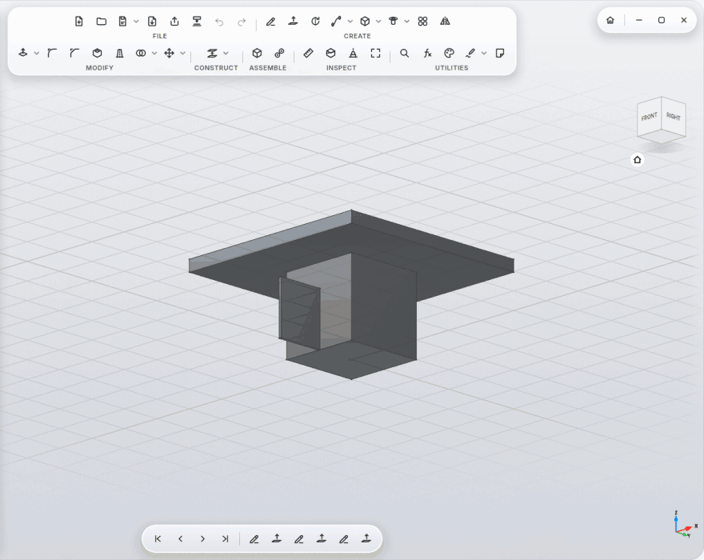

**Fit** makes a hole and its pin fit: with a little play for printing (tight, normal, loose) or exactly to ISO 286 (H7/g6, H7/h6, H7/k6, H7/p6, H8/f7), with the resulting play shown in microns. **Screw Here** joins two parts in one click: a clearance hole with counterbore or countersink in the top part, and a tapped hole, a hole for a heat-set insert or a nut trap in the bottom part, with the screw length picked from the standard. Threads have a 3D print setting that adds the play and warns when the pitch is too fine for a 0.4 mm nozzle.

How much play is right depends on your printer, so measure it once. **Printer Test** opens a fit plate with eight holes, each a little looser than the last, a pin, and a plate with overhangs from 30 to 70° and walls from 0.4 to 1.2 mm. Print it, push the pin in, look at the overhangs, then click in Settings › 3D Printing what fit. From then on every fit, printable thread and the Print View use your printer's numbers.

<br>

## Never lose a thing.

There is no save button to forget. MyCAD saves after every step, as soon as you pause for two seconds, and a new design gets its own folder in your projects folder. Closing never asks. If something crashes, at most the last two seconds are missing.

Every saved state becomes a **version**, kept like Time Machine keeps backups: everything from the last day, then one per hour for a week, then one per day. **Ctrl+S** gives the current state a name. Open any version, **compare** it with today as a ghost over your model (added in green, removed in red, plus the list of changed steps), or **restore** it, which never deletes anything.

Want to try something risky? Make a **variant**. Switch between the main design and its variants right in the browser, compare them, and make a variant the main design when it wins.

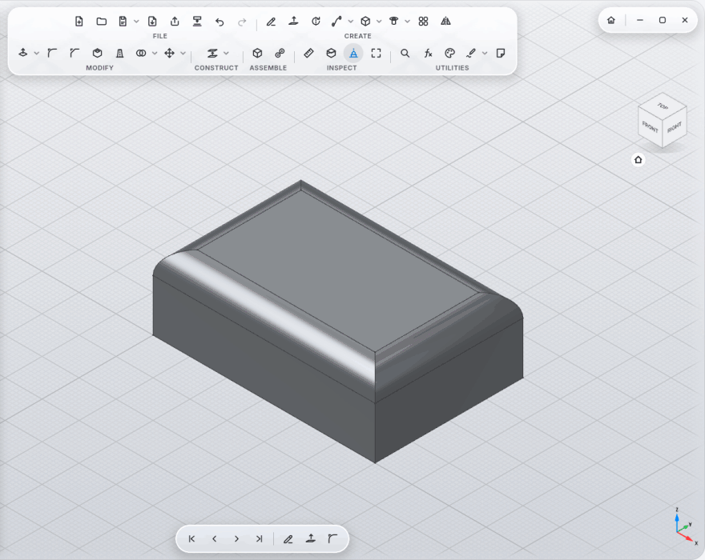

<br>

## Double-click a face. Change a number.

Double-click any face with no tool active and the dimensions that make it appear right next to it: the length of an extrusion, the sketch dimension behind a side face, the diameter of a hole, the radius of a fillet. Type a new value, press Enter, done. If the dimension is a parameter, the parameter changes, and so does the note it lives in.

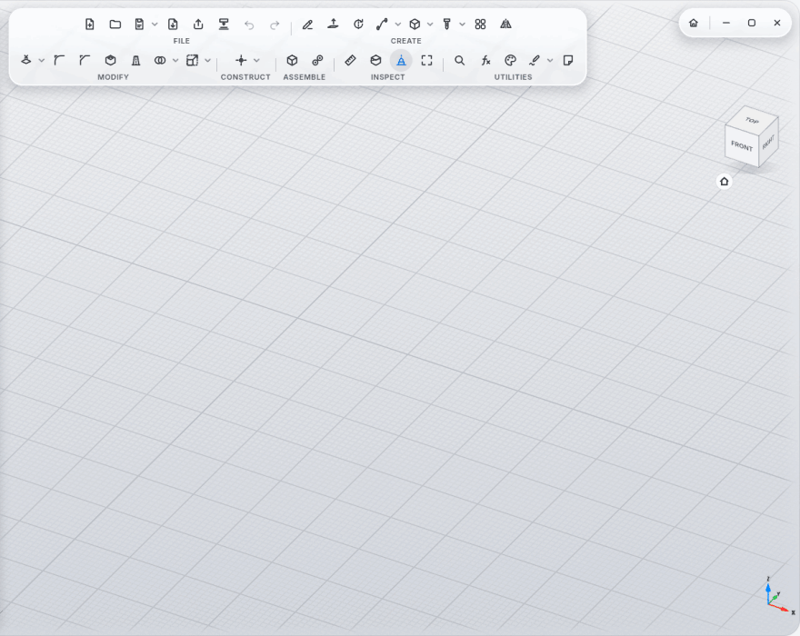

<br>

## Errors that explain themselves.

A fillet too big for its edge? The step turns red in the timeline, the panel says what went wrong in plain words, and it offers the largest radius that still works. One click sets it. The same goes for shells, threads, revolve axes and screws that are too short. When the model changes under a step and an edge might no longer be the one you meant, MyCAD picks the closest match, marks the step, and lets you check it.

<br>

## Notes that stay put.

<div align="center">

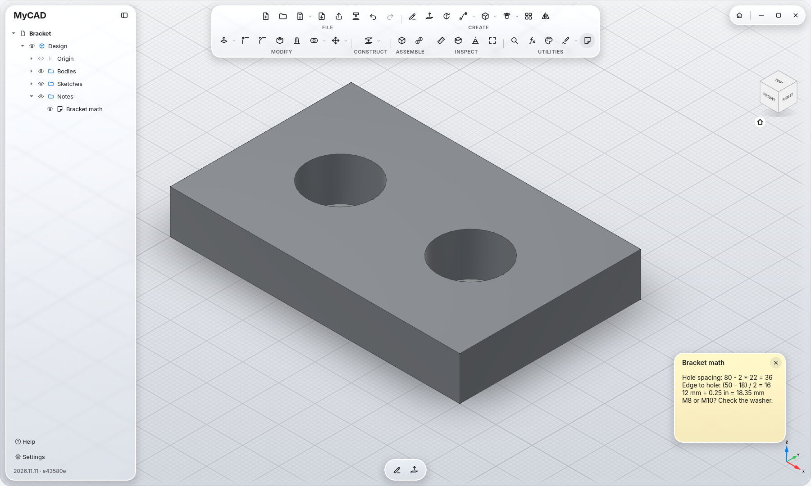

</div>

Click **Note** in the toolbar and a yellow note lands on top of your model. Drag it wherever you want it. It sticks to that corner of the window and stays open while you go in and out of sketches.

It can do the math too. End a line with `=` and the answer appears right after it: type `120 / 4 =` and you get `30`. Units work (`10 mm + 1 in =` gives `35.40 mm`), and so do the names from **Change Parameters**.

And it is your parameter list. Write `Wall = 2 mm` and press Enter: that's a parameter now, ready for any dimension field. Formulas show their value (`Width = Wall * 20 → 40.00 mm`). Change the size on the model and the line in the note changes with it. Delete a line that a dimension still uses, and the parameter stays, with a note saying who needs it. Nothing gets lost quietly. Need the part in several sizes? Write `Size: S | M | L` and give values one per size (`Width = 40 mm | 60 mm | 80 mm`): the sizes show up as buttons on the note, one click switches the part.

Closed a note? It's still under **Notes** in the browser, double-click to open it again. Notes are saved in the design file, so they're still there next time you open it.

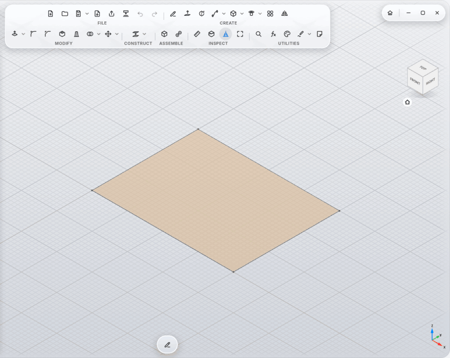

<br>

## Find anything. Ctrl+K.

Press **Ctrl+K** and type. The search finds commands, bodies and sketches, forgives typos, and understands English, German and the words other CAD programs use: *pocket*, *pad*, *push pull*, *Gewinde*, *Passung*, *slicer*. The ones you used last are at the top. It even takes a sentence: *4 holes M3 in the corners, 5 mm from the edge* shows up as the first hit, and Enter opens exactly that, with a preview. *All edges 1 mm chamfer*, *edges 2 mm fillet*, *6 holes M4 on a 40 mm circle* and *5 holes M3 in a row, 10 mm apart* work too, in English or German. *Box 40 x 30 x 10*, *Cylinder Ø20 x 30* and *Shell 2 mm* make bodies the same way. And you can ask: *Why is this red?* names and selects the step that does not compute, *What depends on this?* shows everything that uses the selected sketch or step.

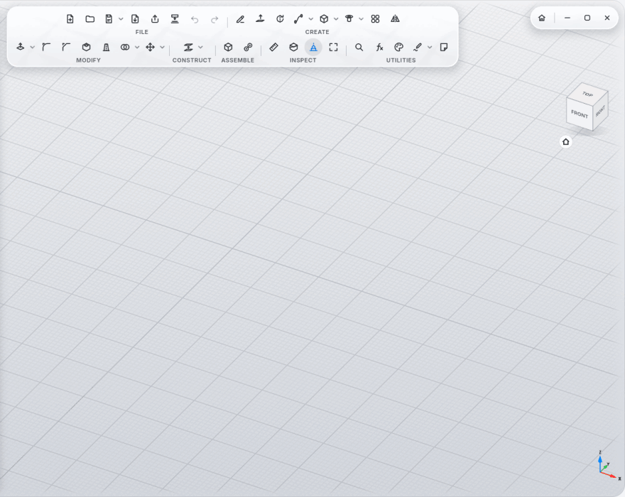

<br>

## Parts that fit together.

Create **components** and connect them with **joints**. Each component has its own bodies, sketches and origin, and all of it lives in a single design file.

Joints come as **Rigid**, **Revolute**, **Slider**, **Cylindrical**, **Pin-Slot**, **Planar** and **Ball**, with limits for angle and travel. **Animate** swings a joint between its limits and shows when parts collide. Chains follow along, and **closed loops** like a four-bar linkage are solved together: the first joint drives, the others follow. **Measure** gives you the mass, material and center of mass of a body, with the material taken from its appearance. For a quick check you don't even need the tool: select two faces, edges or points and their distance (or angle) shows right next to them; click it and it becomes a parameter.

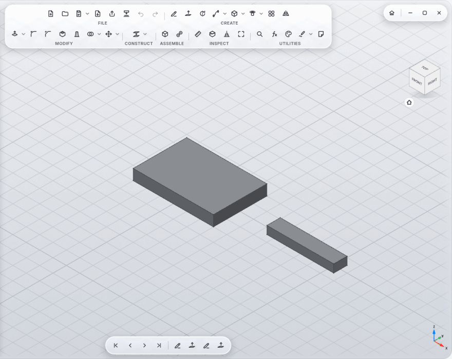

<br>

## Ideas first. Scribble.

<div align="center">

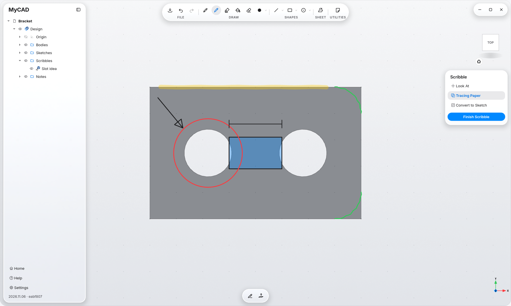

</div>

Click **Scribble** in the toolbar and a sheet of paper with a fine dot grid fills the view. It takes on MyCAD's own light or dark background, and in dark mode your inks get lighter so blue and yellow stay easy to read. Grab your pen tablet and draw with **Pencil**, **Fineliner** or **Marker** in five colors. Press harder and the line gets thicker. Flip the pen over to erase. No eraser on your pen? Press **E**, and **E** again takes you back to the pen.

Hold the pen still at the end of a stroke and it straightens into a clean line, circle or rectangle. Lines snap to horizontal, vertical and to the ends of your other strokes.

Messy handwriting? Just write. A second after you lift the pen, your words glide into place: straight lines, the same size, slant and spacing, still in your own hand. Ctrl+Z brings back the raw version, and **Pen & Handwriting** in Settings makes the tidy-up gentler or turns it off.

MyCAD also reads what you write, offline, with a small model for German handwriting. Sizes come out the CAD way right in your ink: o12 gets its slash and becomes Ø12, 2x45 gets its degree sign, 25mm becomes 25 mm. **Find handwriting** in the palette jumps to any note on the sheet, and **Convert to Sketch** turns an Ø12 written next to a circle into that circle's dimension.

Under **Shapes** you drag out a line, arrow, rectangle, triangle, hexagon, circle or ellipse. **Fill** colors an area: tap inside a shape, or draw around the part you want filled.

To move things around, hold the pen still on a stroke for a moment and it sticks to the pen. **Select** picks up more at once (with the mouse too): tap a stroke or draw around a few, then drag. A small bar under the selection recolors them or deletes them.

No pen tablet at hand? **Text** writes with the keyboard: click on the sheet and type, Enter puts it down. Each line becomes a stroke you can select, move and recolor.

**Tracing Paper** lets the model show through, so you can draw right on top of a part. **Only the Sheet** (Tab) folds the toolbar, browser and palette into a small pill at the top, so it's just you and the paper.

<div align="center">

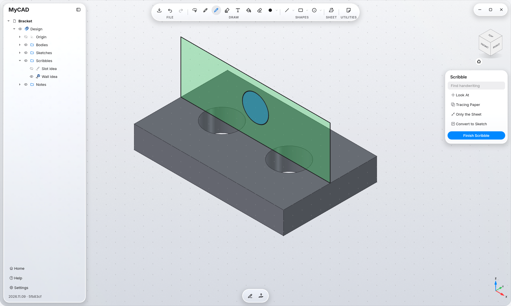

</div>

Then go 3D. **Move Sheet** lays the paper onto any face of your model, or stands it up along a line you drew, so you can sketch a wall or a rib right where it goes. Orbit around it and the paper fades, so you see your strokes and the model together.

Happy with an idea? **Convert to Sketch** turns your lines, circles, ellipses and other shapes into a real sketch, joined up and ready to dimension and extrude. Your scribbles stay in the design under **Scribbles** in the browser.

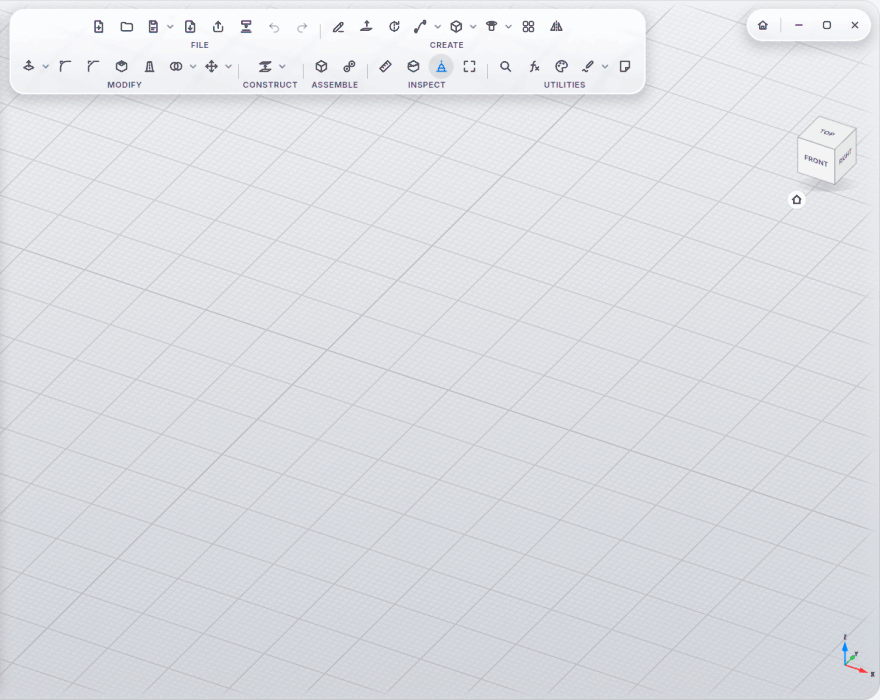

<br>

## Write on it. The Red Pen.

Mark up your model the way you'd mark up a drawing. Pick the **Red Pen**, write `R2` next to an edge, `M5` on a face, `+5` on a face you want thicker, or cross out a face to get rid of it. **Apply Corrections** reads what you wrote and turns each line into a card: `R2 → Fillet R2 on 1 edge`. Point at a card to see its target, **Show** to try it on the model, **Apply** to keep it. If two edges are equally close, the card asks which one instead of guessing.

The red pen knows fillets (`R2`), chamfers (`C2`, `2×45°`), press-pull (`+5`, `−5`), tapped holes and threads (`M5`), holes and diameters (`Ø8`), fits (`H7`, `print`), patterns (`3×`), plain dimensions (`12`) and removing a face (`remove`, or a line through it). German works too: `Druck`, `weg`. Every correction becomes a normal step in the timeline.

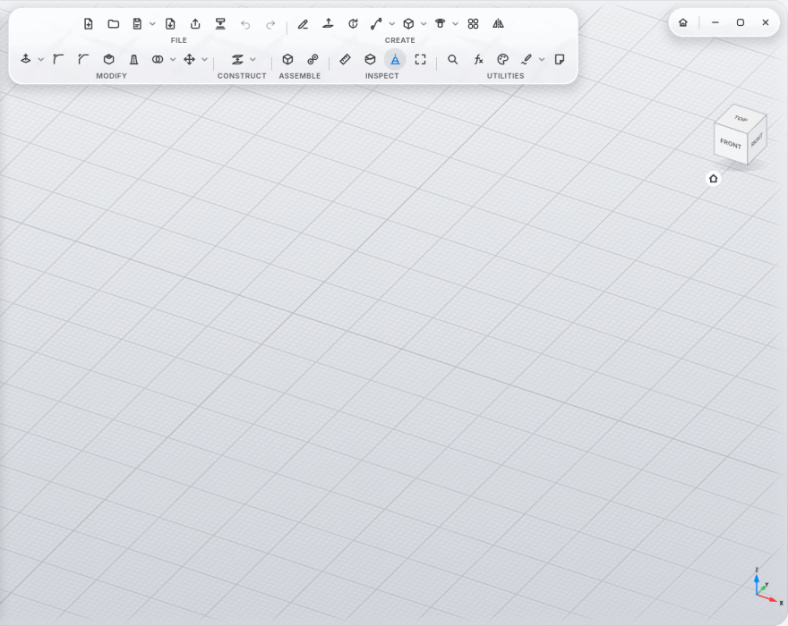

<br>

## Your hands. Your rules.

Choose from twelve navigation styles, including **Fusion 360**, **SolidWorks**, **Blender**, **Siemens NX** and **Touchpad**. MyCAD shows you which key or gesture orbits, pans, zooms and selects in the style you picked.

You can map a key to a mouse button, for example **Shift** as the middle button, and then navigate with your touchpad. Shift still works as Shift when you type. MyCAD orbits around the body under your cursor. If you'd rather see names than icons, turn on **Show tool names**.

Pen tablets work on Wayland with pressure and hover. **Tablet** in Settings gives every button its job: pick your model (MyCAD recognizes it when it's plugged in), press a button and its row lights up, then choose what it does. Undo, eraser, select, pencil, fineliner, marker, next color, Only the Sheet, look at the sheet, or orbit and pan while you hold it. The Huion Inspiroy H640P comes set up for its six buttons and two on the pen. Models MyCAD doesn't know yet learn their buttons as you press them. Reading the tablet's buttons needs permission once: **Allow Access…** asks for your password and lets MyCAD read tablet buttons (never keyboards). If KDE still has shortcuts on the same buttons, MyCAD ignores them, so nothing happens twice.

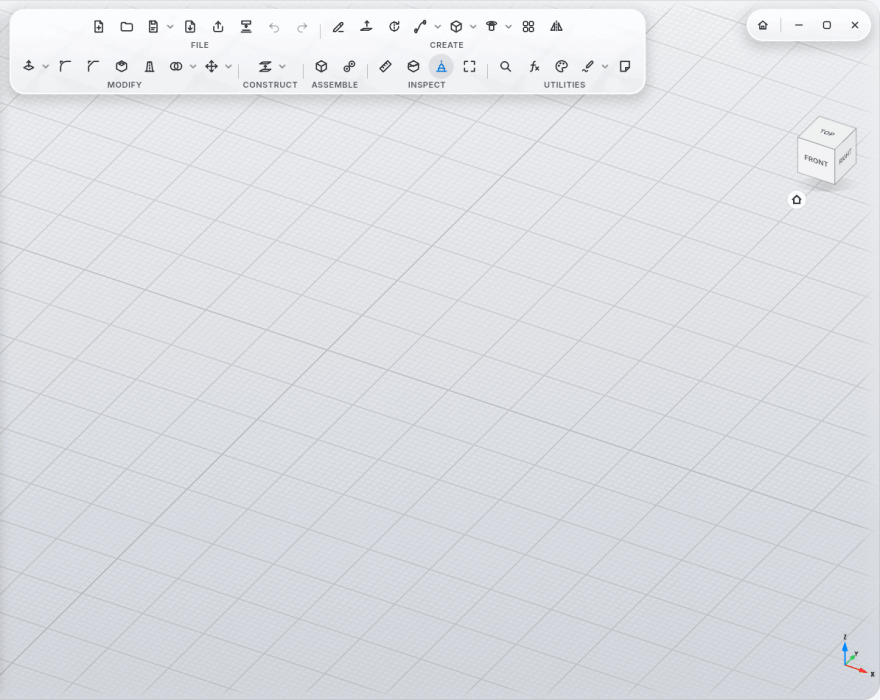

<br>

## Liquid Glass. Down to the last pixel.

Every surface in MyCAD is made of glass. The toolbar, browser, window buttons and inspector float above your model, so you can still see the model behind them. A custom GPU shader blurs the background, bends it at the edges like a real lens, and adds a thin highlight and a soft shadow. It all runs in real time while you orbit.

The **Liquid Glass** slider in Settings works like the one in iOS 27: slide it from **Ultra Clear** to see more of your design through the glass, or towards **Tinted** for a denser, easier-to-read glass. **Default** sits in the middle.

MyCAD comes in **Light** and **Dark**. **Automatic** follows your desktop. Dark mode is made for modeling: a calm dark-gray background instead of black, white lines for fully constrained sketches, and a subtle grid. Increase Contrast, Reduce Transparency and Reduce Motion are built in.

Messages show up as floating glass alerts with no window frame and capsule-shaped buttons. Corners are rounded concentrically and icons are monochrome.

<br>

## Materials with character.

<div align="center">

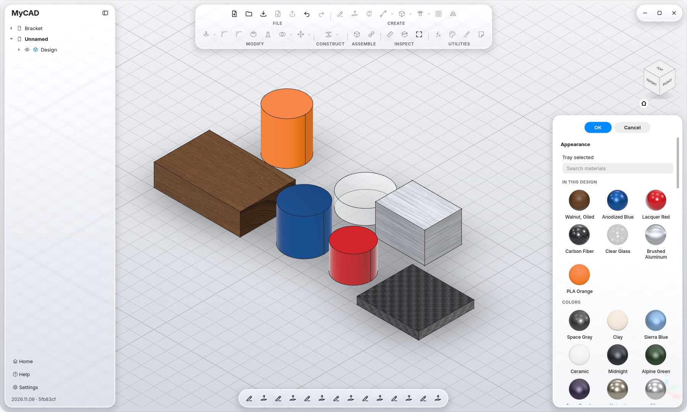

</div>

Bodies stand in a photo studio: a large light from the top left, a softer one from the right, a gray floor. Every face of a body gets its own shade, so a part reads at a glance, even in the flat CAD view. Metal mirrors the lights, red lacquer shines under its clear coat, and glass stays see-through but still reflects. Prefer it softer? Switch **Lighting** to **Room**, the even light of a product preview in the browser. New bodies come in satin **Steel**. Pick another default in the settings and your existing bodies switch right away.

**Appearance** has 119 materials: raw and polished metals, anodized aluminum in nine colors, powder coat, lacquer and metallic paint, matte, satin and glossy plastics, PLA that shows its print layers up close, rubber and silicone, glass and acrylic, woods raw, oiled or lacquered, stone and ceramics, leather, felt and carbon. Each one is a small sphere drawn the same way as your model, with its colors and finishes as dots underneath. Search by name, right-click to keep a favorite, and see at the top what this design already uses. Click a sphere to apply it to the selected bodies, or drag it straight onto a body. With single faces selected, only those faces change color.

The woods, stone, leather, cork, fabric, carbon and brushed metals are real photo scans with their relief, and a wooden part shows end grain where it's cut. A soft shadow grounds every body on the grid. Under **Materials and Light** in the settings you choose the lighting and can switch each of these off on its own: realistic materials, reflections, relief and end grain, and the contact shadow. Turn off what gets in your way, or what your graphics card can't keep up with.

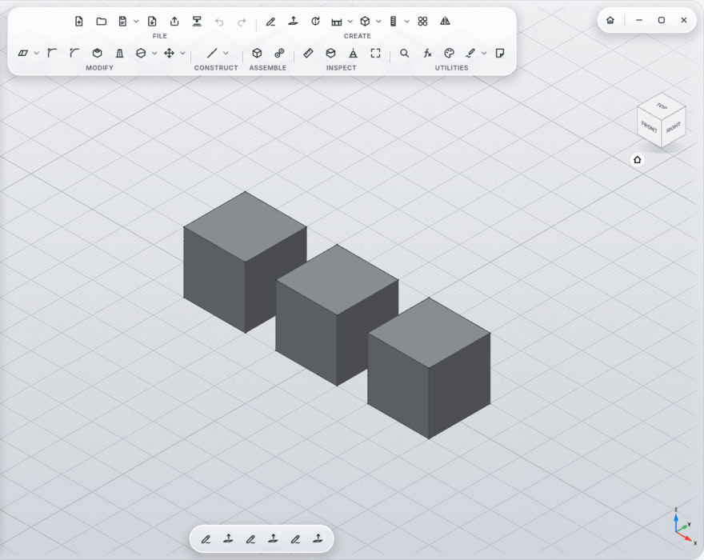

<br>

## Speaks your language.

Switch to **Deutsch** in the settings and MyCAD is in German, from the toolbar down to the error messages. The terms are the ones you know from the German version of Fusion 360 (Extrudieren, Drehen, Abrunden, Bohrung, Gelenk), and new sketches and bodies are called Skizze1 and Körper1.

<br>

## Everything at a glance.

<div align="center">

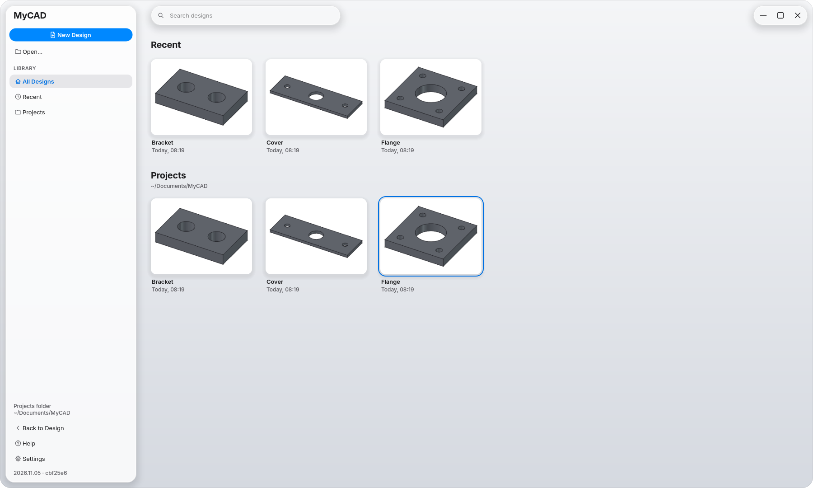

</div>

The start page lists your recent designs and everything in your project folder, each with a large preview. Type a few letters into the search box to find a part, then click it to pick up where you left off. Right-click a design to rename it (its project folder and versions follow) or move it to the trash. **Home** at the top right brings you back here at any time, and the back arrow next to it returns you to your design. **New from Template** starts with a finished design instead: a box with lid, a wall bracket, a PCB enclosure, a spacer or a cable clip. Their sizes stand in a note, one per line; change a number, press Enter, and the design follows. Coming from Fusion? The help has a page that maps its terms and keys.

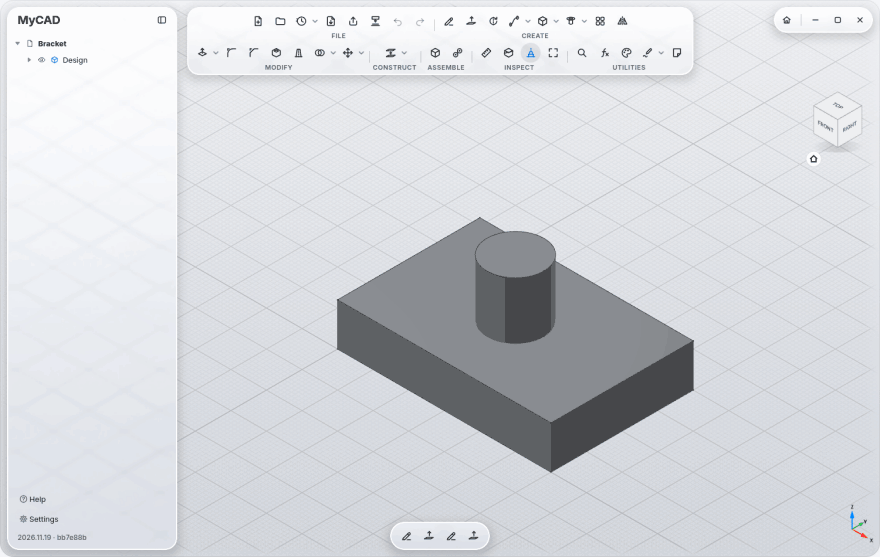

<br>

## Speaks STEP. And STL. And DXF.

**Export** to STL or 3MF for your 3D printer, or to STEP for any other CAD program. Sketches export as DXF, for example for laser cutters or CNC mills. **Import** STEP models, and bring DXF and SVG drawings straight into a sketch.

**Remix an STL.** Insert an STL, 3MF or OBJ from Printables or Thingiverse and it becomes a body you can work with, not a cloud of triangles. Flat areas become one face each, round holes become real holes with a centre and a diameter, so you can measure them, sketch on a face, add a fit or a screw, cut and combine. A plate with 24 holes and 100 000 triangles turns into a clean body in under a second. Bosses, fillets and free-form shapes stay made of triangles.

**Hardware included.** Standard Part adds screws (ISO 4762, 10642, 7380), nuts, washers, heat-set inserts, ball bearings like the 608, magnets and 2020 aluminum profiles as real bodies with their standard sizes. Check that everything fits, then open the **Parts List**: it counts what you need and copies it as a table, ready for your order. **Gear** makes spur gears with real involute teeth: same module, the right distance, and two gears mesh. **Hinge** prints in one piece and moves right off the bed, with the play from your Printer Test. **Snap Hook** checks how far the beam bends and suggests a length that does not break.

**Code when you want it.** A **Code Step** is a step in the timeline made from a few lines of Python: `result = cut(box(p.Width, 30, 5), cylinder(8, 5))`. Sizes come from your notes, so changing a note changes the part. Code is a program, so it never starts by itself: a step from a file someone sent you stays red until you have read it and clicked **Run**.

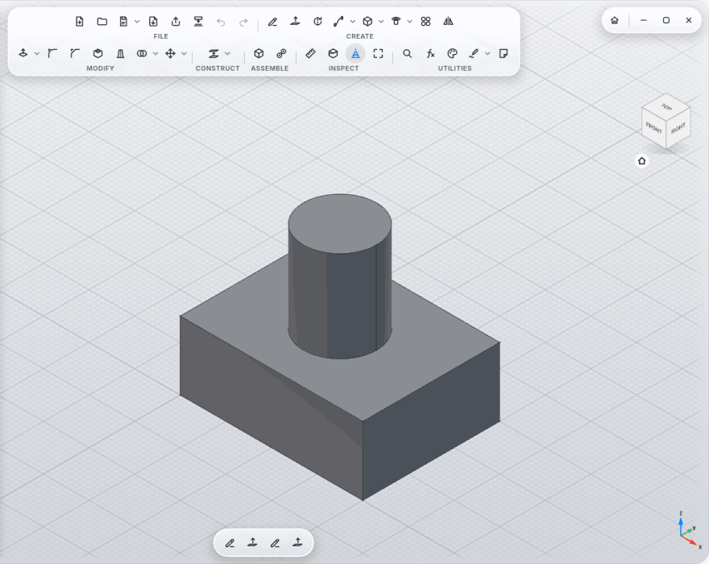

<br>

## Coming next.

MyCAD is young and grows fast. This is what comes next, roughly in this order (details in the [roadmap](docs/PLAN.md)):

- **Workshop sheet.** One click makes a PDF with views, a table of holes, threads and fits, and the main dimensions, ready for whoever machines the part.
- **Flathub**, so MyCAD installs on any Linux.
- Screw Here that also places the screw, multi-color painting for AMS and MMU printers, splitting parts that are too big for the bed, and a local assistant that turns a sentence into steps, offline.

<br>

## Tech specs

| | |
|---|---|
| **Platform** | Linux, developed and tested on CachyOS with KDE Plasma (Wayland); the AppImage needs an Arch-based system for now, Flathub is coming |
| **Interface** | Liquid Glass with a GPU glass shader, light and dark mode, English or German |
| **Model** | Parametric, with a global timeline (reorder, groups, roll back, hover shows the body, select a body to fade the rest), components and joints |
| **Sketch** | 12 drawing tools, 7 modify tools, 9 constraints, one dimension tool |
| **Solids** | 21 create, 14 modify and 6 construction tools; standard holes, printable threads, Fit (ISO 286 and 3D print), Screw Here, Remove Face, standard parts (screws, nuts, washers, heat-set inserts, bearings, magnets, 2020 profiles) with a parts list, involute spur gears, print-in-place hinges, snap hooks with a strain check |
| **Dimensions** | Double-click a face to change the dimensions that make it; errors explain themselves and offer a value that works |
| **Notes** | Saved in the design, lines ending in `=` are calculated, `Name = value` lines are parameters (both ways) |
| **Red Pen** | Handwritten corrections on the model become features: R, C, ±, M, Ø, H7, 3×, dimensions, remove face |
| **3D printing** | Print View (overhangs, bed, thin walls), print direction (chosen or suggested), bed size check, Printer Test (clearance, overhang, wall), Print to OrcaSlicer, Bambu Studio, PrusaSlicer and Cura (program, Flatpak, AppImage) |
| **Saving** | Always saved, versions with Time Machine retention, compare as a ghost, restore, variants |
| **Assembly** | 7 joint types with limits, animate with collisions, chains, closed loops solved with OndselSolver, mass and center of mass |
| **Search** | Ctrl+K for commands, bodies and sketches, typo-tolerant, English and German |
| **Scribbles** | Pen tablet with pressure, 7 shapes, fill, text, select and move with a color and delete bar, sheets in 3D, convert to sketch, handwriting tidy-up, offline handwriting recognition (find, CAD notation, written dimensions), Only the Sheet mode |
| **Export** | STL · 3MF (with colors, per face too) · STEP (with colors) · DXF (sketches) |
| **Import** | STEP · STL, 3MF, OBJ (flat faces and holes recognized) · DXF · SVG · photos (traced into a sketch) |
| **File format** | `.mycad` (ZIP with preview image, same content as FreeCAD's FCStd); `.FCStd` files open too |
| **Navigation** | 12 styles, keys as mouse buttons, orbit around the body under the cursor |
| **Pen tablet** | Pressure and hover on Wayland, every tablet and pen button assignable in Settings (H640P preset, other models learn their buttons), KDE shortcuts on the same buttons ignored |
| **Materials** | 119 in 12 groups (metal, anodized, coatings, plastic, 3D print, rubber, glass, wood, stone, fabric and leather, composites, Apple colors), 19 CC0 photo scans with relief, studio or room lighting, clear coat, end grain, contact shadow |
| **Core** | FreeCAD with OpenCascade 8.0 and Coin 4.0.10 (built in the container) |
| **License** | LGPL-2.1-or-later |

<br>

## Download. Run. Done.

The latest version is always on the [**Releases**](https://github.com/HanreichC/MyCAD/releases/latest) page as an AppImage, rebuilt every night when something changed. There's nothing to install and no container to set up, just one file:

```sh
chmod +x MyCAD-*-x86_64.AppImage
./MyCAD-*-x86_64.AppImage
```

The AppImage is built for current Arch-based systems such as CachyOS. On Ubuntu, Fedora and other distributions, build it yourself (below) until MyCAD is on Flathub.

<br>

## Or build it yourself.

```sh
git clone --recursive https://github.com/HanreichC/MyCAD.git   # --recursive fetches the joint solver
cd MyCAD
./install.sh   # builds MyCAD in a Podman (or Docker) container and adds the `mycad` launcher and a menu entry
mycad          # starts MyCAD
```

The build runs inside a Podman container (`.devcontainer/`), or Docker if there is no Podman (`ENGINE=docker ./install.sh` picks it), so the compiler and dependencies stay off your system. Running it again only rebuilds what changed. `JOBS=8 ./install.sh` sets how many cores to use (the default is 8, at lowest priority).

**You need** Linux with Wayland, Podman or Docker, and a GPU with OpenGL. Windows 11 works too, through WSL2 (the Linux in Windows, with its WSLg display): install Ubuntu there, then the same three lines.

<br>

## For developers.

The core of the interface lives in [`src/Gui/Shell/`](src/Gui/Shell) and the Fusion-style tools in [`src/Mod/Design/`](src/Mod/Design). [`tools/make_icons.py`](tools/make_icons.py) generates the icons. [`tools/fetch_textures.py`](tools/fetch_textures.py) downloads the photo scans for the materials, and [`tools/make_environment.py`](tools/make_environment.py) renders the studio and the room that light the bodies. [`tests/gui/test_materials.py`](tests/gui/test_materials.py) checks the three shades of a box, reflections, end grain and the contact shadow.

The GUI tests click through the app like a person would, with real mouse and keyboard events:

```sh
tests/gui/run.sh tests/gui/test_ring.py /tmp/ring   # log in /tmp/ring.txt, screenshot in /tmp/ring.png
```

The scribble math runs without FreeCAD. [`tests/scribble_tidy_check.cpp`](tests/scribble_tidy_check.cpp) checks the handwriting tidy-up, [`tests/scribble_read_check.cpp`](tests/scribble_read_check.cpp) reads synthetic handwriting with the real model, and [`tests/gui/test_handwriting.py`](tests/gui/test_handwriting.py) writes with the mouse and a simulated pen tablet in the running app.

All tests at once, inside the container: `GUI=ci tests/run_all.sh` (logic checks without FreeCAD, headless model tests, GUI tests).

The roadmap is in [`docs/PLAN.md`](docs/PLAN.md). The [wiki](https://github.com/HanreichC/MyCAD/wiki) explains every feature and has tutorials; its pages also live in [`docs/wiki/`](docs/wiki). Inside the app, the built-in help (**?** at the bottom left, source in [`tools/help_content.py`](tools/help_content.py)) covers every tool in English and German, with an overview and two tutorials under Getting Started.

<br>

## Origins and license.

MyCAD is built on [FreeCAD](https://www.freecad.org), the free parametric CAD program. Thanks to everyone who works on it. [`docs/UPSTREAM.md`](docs/UPSTREAM.md) has the details.

Like FreeCAD, MyCAD is licensed under the [LGPL-2.1-or-later](LICENSE).

The material scans come from [Poly Haven](https://polyhaven.com) and [ambientCG](https://ambientcg.com), both CC0. [`src/Gui/Shell/textures/SOURCES.md`](src/Gui/Shell/textures/SOURCES.md) lists each one.

Closed joint loops are solved with [OndselSolver](https://github.com/FreeCAD/OndselSolver) (LGPL-2.1), in the version maintained by the FreeCAD project.

Handwriting recognition uses [DE·HTR v2](https://huggingface.co/naeyn/de-htr-web-v2) (Apache-2.0), trained on the ScaDS.AI German handwriting dataset (CC BY 4.0, Universität Leipzig) and fhswf/german_handwriting (AFL-3.0). Details in [`src/Mod/Design/Gui/htr/`](src/Mod/Design/Gui/htr/README.md).

<sub>MyCAD is an independent project and is not affiliated with Apple Inc. or Autodesk, Inc. Liquid Glass is a design language by Apple, and Fusion 360 is a trademark of Autodesk. Both names are used here only to describe the style and workflow.</sub>
