# 3D Printing

MyCAD is made for people who print. Everything that matters is built in, from the play between parts to your slicer.

## Print View

**Print View** (INSPECT section) shows on the model what your printer will struggle with. Patterns, not just colors, so
it reads without color vision too:

| Pattern | Meaning |
|---|---|
| hatched red | overhang flatter than the overhang angle (45° by default): needs supports |
| dotted green | lies on the print bed |
| cross-hatched yellow | wall thinner than the minimum wall (0.8 mm by default) |

- **Choose Bottom Face:** click the face that should lie on the bed, then **Choose Bottom Face** in the legend. The print
  direction is saved with the design and used by **Print**.
- **Make printable:** the legend lists what one setting would fix, with **Apply** (or **Apply All**; Ctrl+Z undoes):
  - a hole across the print direction becomes a **teardrop** with a 45° tip (no supports inside the hole),
  - a fillet **chamfers its bottom edges** at 45° and stays round on top,
  - a shell or thin-wall extrude that is too thin grows to the **minimum wall**.
  The same options are in the Hole and Fillet panels (Teardrop for printing, Chamfer bottom edges for printing).
- Overhang angle and minimum wall are in **Settings**.
- The **Print View** button stays pressed while it is on; **Exit Print View** in the legend (or another click on the
  button) hides it.

  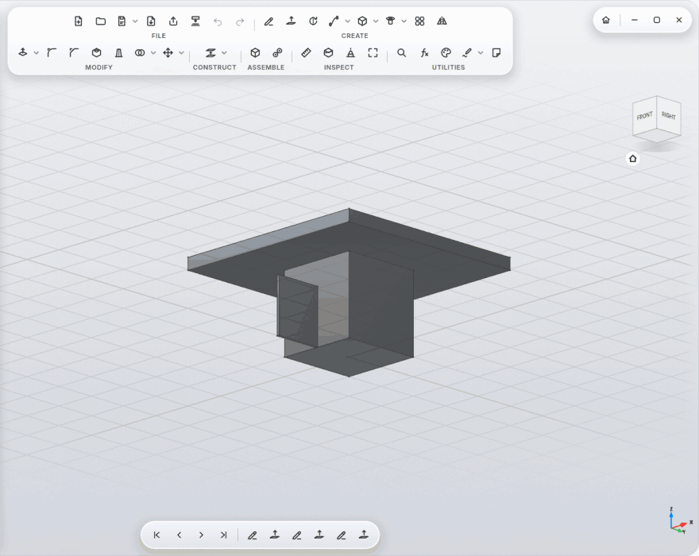

## Lay it down, cut it up

- **Suggest Orientation** (legend, or PRINT): tries every flat face and each axis as the bottom and takes the lay with
  the least support material and the lowest height that fits your bed. Ctrl+Z puts it back.
- **Bed size** (Settings › 3D Printing, 220 × 220 × 250 by default): a design larger than the bed in its lay shows up in
  red in the legend, with its size.
- **Split for Printing** (**Split** in the legend, or PRINT): cuts the part across the direction that is too long into as
  many equal pieces as needed. **Pins** grow on one side of each cut, the other side gets holes with your print
  clearance; **Dovetail** instead slides together and cannot pull apart (Connector in the step's panel).

## Print

**Print** (FILE section, or in the legend) opens the visible (or selected) bodies in your slicer: as a 3MF with names and
colors, the chosen bottom face down.

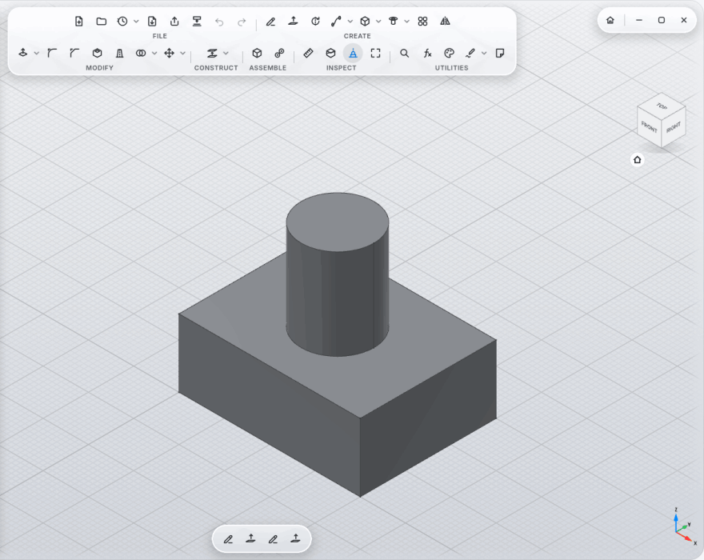

MyCAD finds:

| Slicer | as a program | Flatpak | AppImage in `~/Applications` |
|---|---|---|---|
| OrcaSlicer | `orca-slicer` | `io.github.softfever.OrcaSlicer` | `OrcaSlicer*.AppImage` |
| Bambu Studio | `bambu-studio` | `com.bambulab.BambuStudio` | `Bambu_Studio*.AppImage` |
| PrusaSlicer | `prusa-slicer` | `com.prusa3d.PrusaSlicer` | `PrusaSlicer*.AppImage` |
| UltiMaker Cura | `cura`, `UltiMaker-Cura` | `com.ultimaker.cura` | `UltiMaker-Cura*.AppImage` |

- With more than one installed, MyCAD asks once and remembers your choice.
- **Flatpak:** the file is handed to the slicer through the document portal
  (`flatpak run --file-forwarding … @@ file @@`), so it can see it inside its sandbox.
- The slicer starts without MyCAD's own library paths and in your desktop's language.
- With no slicer installed, **Print** offers to save a 3MF file instead.
- How fine curves get is set by **Export resolution** (coarse/normal/fine) in Settings.

## Fit

Select a hole and its pin (or flat faces), **Fit** (MODIFY section):

- **3D print tight / normal / loose:** the hole gets wider by the play on each side (0.1 / 0.2 / 0.3 mm by default,
  adjustable under Settings → 3D print clearance). Without a hole, the pin gets thinner; flat faces move back.
- **ISO 286:** H7/g6 (sliding), H7/h6 (close sliding), H7/k6 (transition), H7/p6 (press fit), H8/f7 (running).
  Both faces move to the middle of their tolerance field; the play shows in the panel, e.g. `+7 … +41 µm`.
- The hole and the pin may be in two different bodies.

  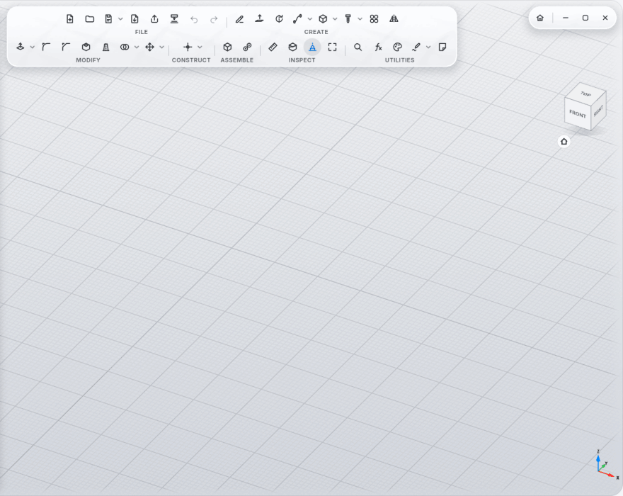

## Measure your printer: Printer Test

**Printer Test** (PRINT, or Settings › 3D Printing › Make Test Piece) opens a new design with three parts: a fit plate
with holes 1 to 8 (each 0.05 mm more play per side), a pin, and a plate with overhangs from 30 to 70° and walls from 0.4
to 1.2 mm. Print them with your usual settings, push the pin into the holes and look at the overhangs and walls. Then
click in Settings › 3D Printing the first hole the pin slides into, the last clean overhang and the thinnest whole wall.
Fit, printable threads, gears, hinges, snap recesses and the Print View use these numbers from then on.

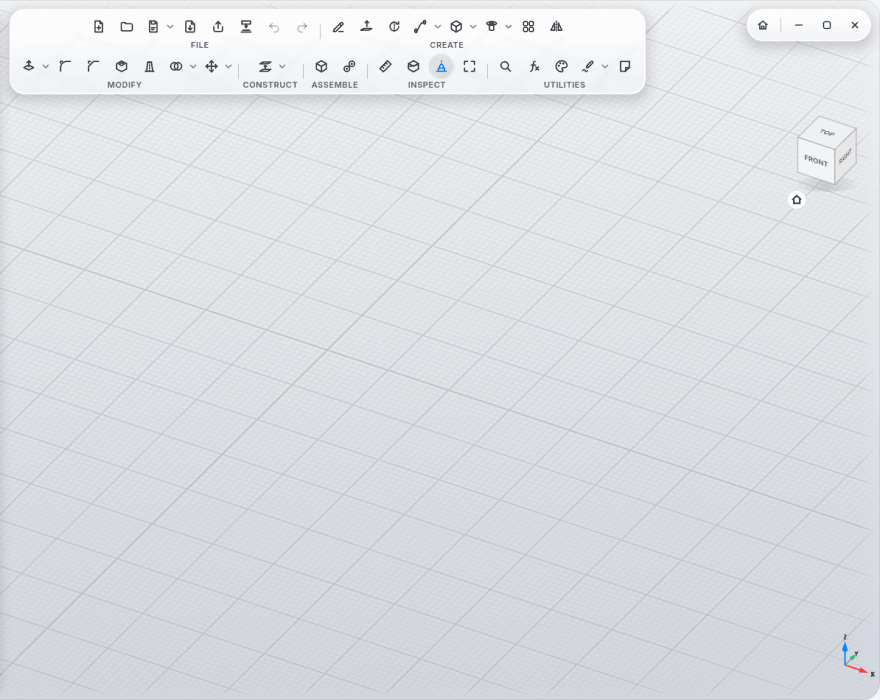

## Parts that print and move

- **Hinge** (CREATE): prints in one piece, flat on the bed, and moves as soon as it comes off: two leaves, knuckles in
  turn and a pin with play all around.
- **Snap Hook** (CREATE): a flexing beam with a catch. MyCAD checks the bending and offers a beam length that holds.
  **Snap Recess** cuts the matching window into the part over the catch, with play, and follows the hook. Print the
  beam lying down.
- **Gear** (CREATE): involute spur gears with backlash from your printer profile.
- **Standard Part** and **Parts List**: screws, nuts, heat-set inserts, bearings and magnets as bodies, then a list of
  what to buy.

| | |
|---|---|
| **Hinge** 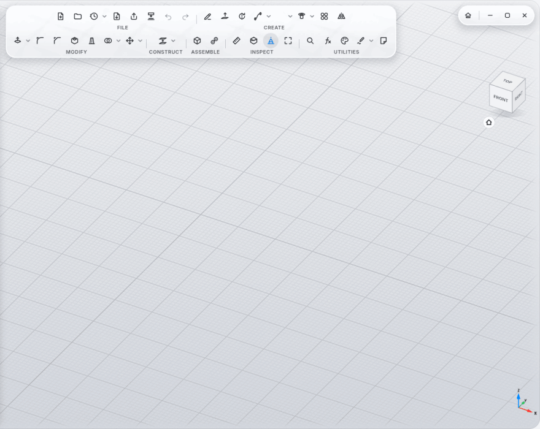 | **Snap Hook and Snap Recess** 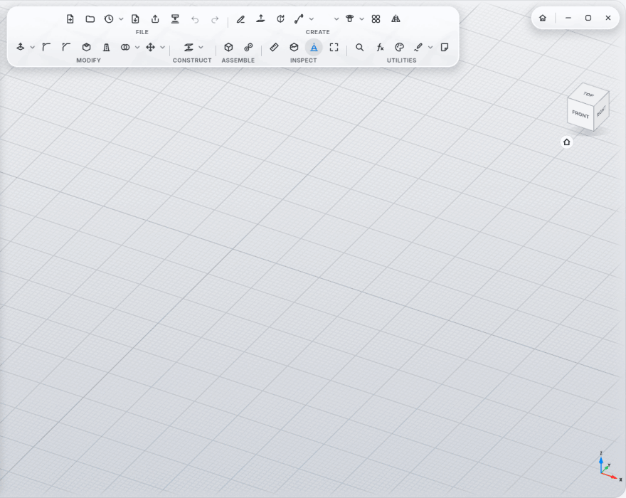 |
| **Gear** 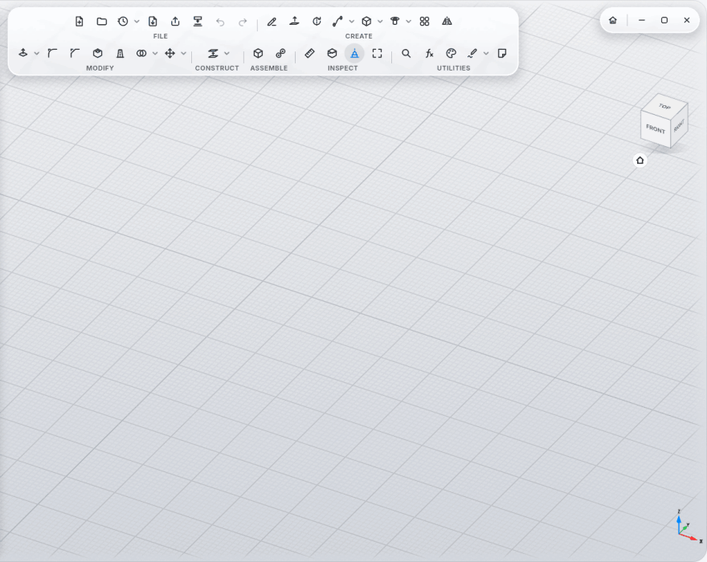 | **Parts List** 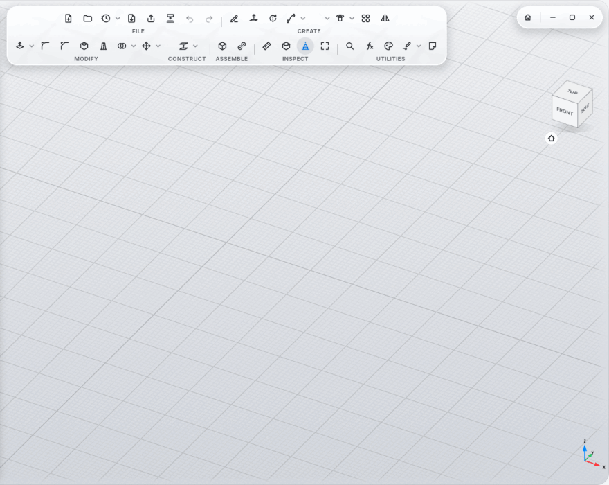 |

## Screw Here

Click the top face of the upper part (or the edge of a round hole), **Screw Here** (arrow ▾ next to Hole). The lower part
is the next body behind that point, even in another component.

- **Screw:** ISO 4762 (socket head, sunk), ISO 10642 (countersunk, flush), ISO 7380 (button head); M2 to M12.
- **Bottom:** Tapped hole, **Heat-set insert** (a hole for brass inserts, e.g. M3: Ø4 × 5.7 mm) or **Nut trap** (a
  hexagon pocket on the underside).
- **Length:** the shortest standard length that holds; pick one that's too short by hand and MyCAD suggests a longer one.

  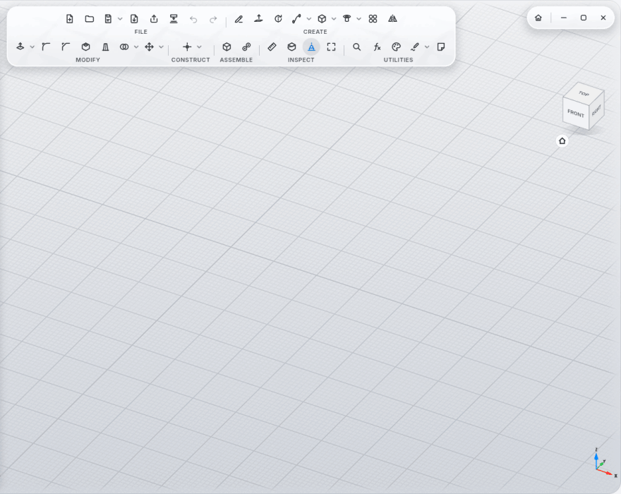

## Threads for printing

On **Thread**, tick "Clearance for 3D printing": the play is added automatically (at most a quarter of the pitch), and
below 1 mm pitch (smaller than M8) MyCAD warns that it prints poorly with a 0.4 mm nozzle.

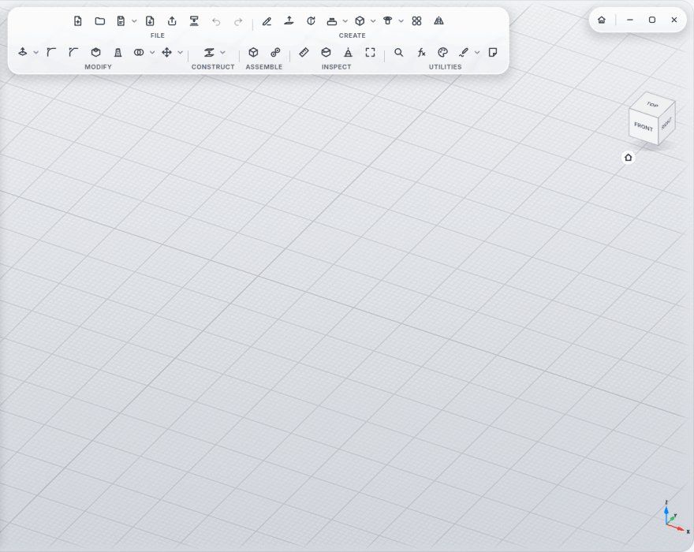

## Export

**Export** as **3MF** (one object per body, with name and color, faces you colored on their own keep their color), **STL**, **STEP** (with colors and structure) and
**DXF** (sketches, e.g. for laser cutters and CNC).

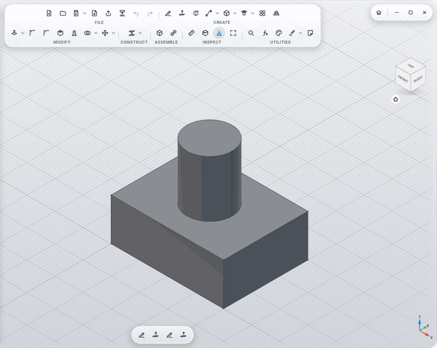
