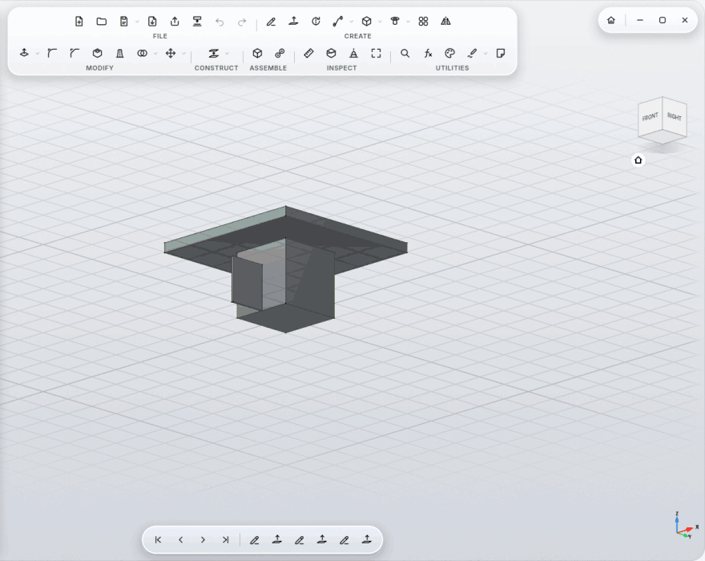
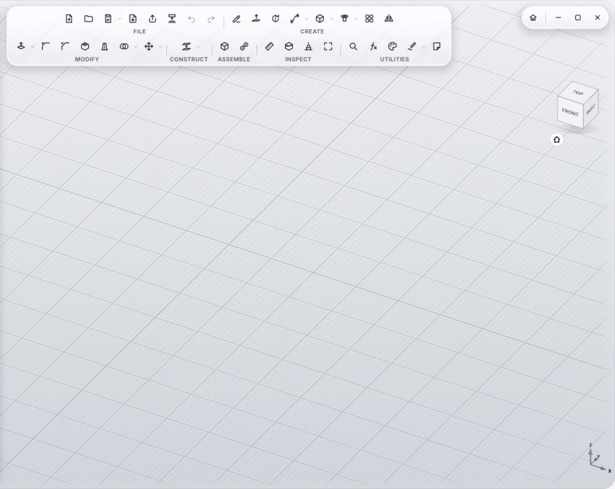
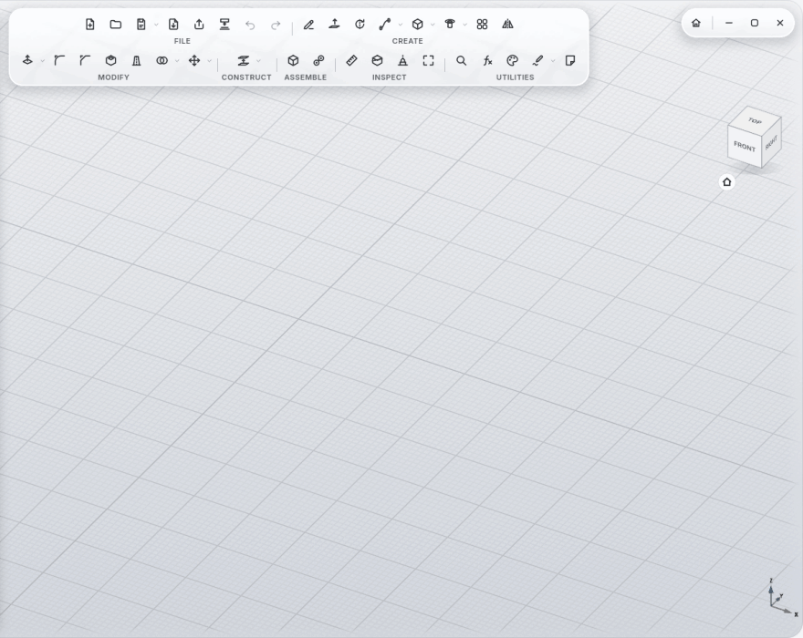
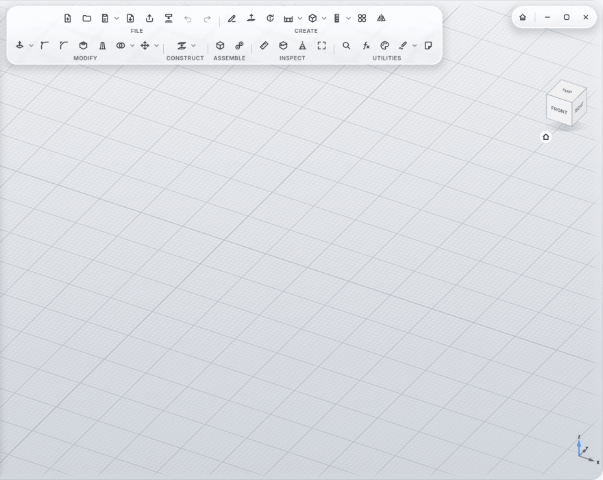
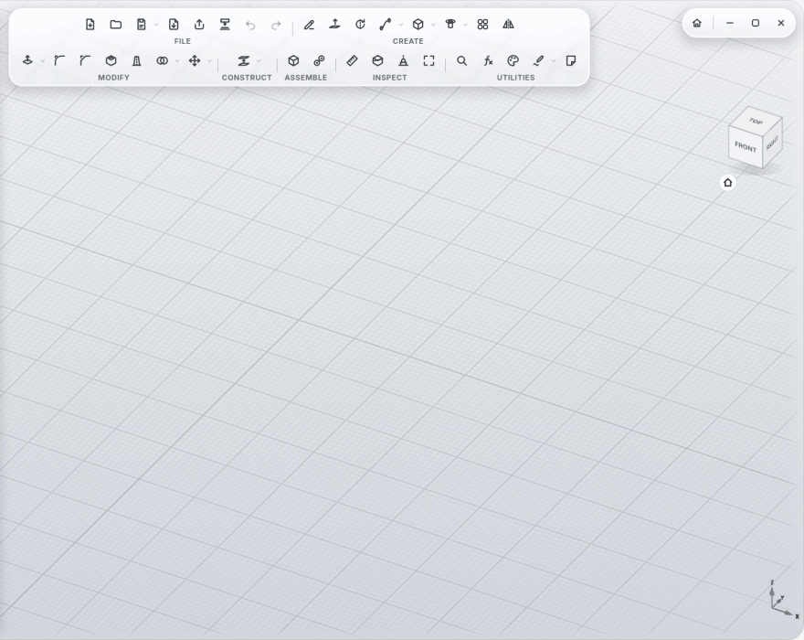
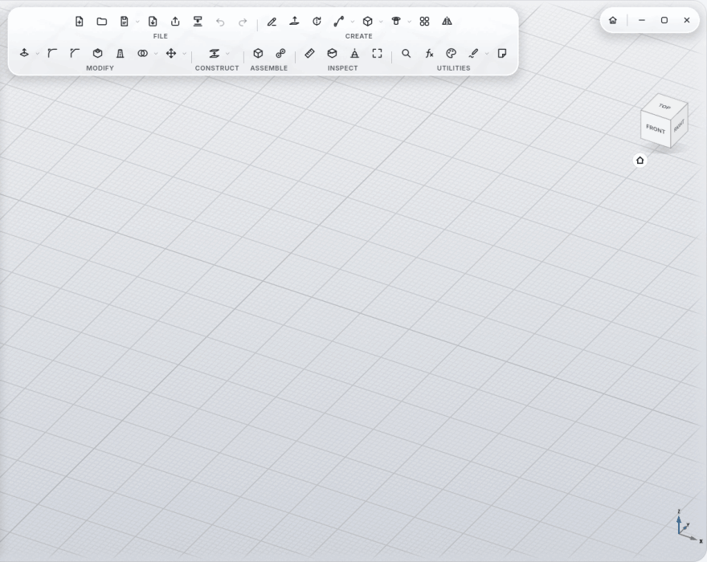

# 3D Printing

MyCAD is made for people who print. Everything that matters is built in, from the play between parts to your slicer.

## Print View

**Print View** (INSPECT section) shows on the model what your printer will struggle with. Patterns, not just colors, so
it reads without color vision too:

| Pattern | Meaning |
|---|---|
| hatched red | overhang flatter than the overhang angle (45° by default): needs supports |
| dotted green | lies on the print bed |
| cross-hatched yellow | wall thinner than the minimum wall (0.8 mm by default) |

- **Choose Bottom Face:** click the face that should lie on the bed, then **Choose Bottom Face** in the legend. The print
  direction is saved with the design and used by **Print**.
- Overhang angle and minimum wall are in **Settings**.
- Click **Print View** again to hide it.

  

## Print

**Print** (FILE section, or in the legend) opens the visible (or selected) bodies in your slicer: as a 3MF with names and
colors, the chosen bottom face down.

MyCAD finds:

| Slicer | as a program | Flatpak | AppImage in `~/Applications` |
|---|---|---|---|
| OrcaSlicer | `orca-slicer` | `io.github.softfever.OrcaSlicer` | `OrcaSlicer*.AppImage` |
| Bambu Studio | `bambu-studio` | `com.bambulab.BambuStudio` | `Bambu_Studio*.AppImage` |
| PrusaSlicer | `prusa-slicer` | `com.prusa3d.PrusaSlicer` | `PrusaSlicer*.AppImage` |
| UltiMaker Cura | `cura`, `UltiMaker-Cura` | `com.ultimaker.cura` | `UltiMaker-Cura*.AppImage` |

- With more than one installed, MyCAD asks once and remembers your choice.
- **Flatpak:** the file is handed to the slicer through the document portal
  (`flatpak run --file-forwarding … @@ file @@`), so it can see it inside its sandbox.
- The slicer starts without MyCAD's own library paths and in your desktop's language.
- With no slicer installed, **Print** offers to save a 3MF file instead.
- How fine curves get is set by **Export resolution** (coarse/normal/fine) in Settings.

## Fit

Select a hole and its pin (or flat faces), **Fit** (MODIFY section):

- **3D print tight / normal / loose:** the hole gets wider by the play on each side (0.1 / 0.2 / 0.3 mm by default,
  adjustable under Settings → 3D print clearance). Without a hole, the pin gets thinner; flat faces move back.
- **ISO 286:** H7/g6 (sliding), H7/h6 (close sliding), H7/k6 (transition), H7/p6 (press fit), H8/f7 (running).
  Both faces move to the middle of their tolerance field; the play shows in the panel, e.g. `+7 … +41 µm`.
- The hole and the pin may be in two different bodies.

  

## Screw Here

Click the top face of the upper part (or the edge of a round hole), **Screw Here** (arrow ▾ next to Hole). The lower part
is the next body behind that point, even in another component.

- **Screw:** ISO 4762 (socket head, sunk), ISO 10642 (countersunk, flush), ISO 7380 (button head); M2 to M12.
- **Bottom:** Tapped hole, **Heat-set insert** (a hole for brass inserts, e.g. M3: Ø4 × 5.7 mm) or **Nut trap** (a
  hexagon pocket on the underside).
- **Length:** the shortest standard length that holds; pick one that's too short by hand and MyCAD suggests a longer one.

  

## Threads for printing

On **Thread**, tick "Clearance for 3D printing": the play is added automatically (at most a quarter of the pitch), and
below 1 mm pitch (smaller than M8) MyCAD warns that it prints poorly with a 0.4 mm nozzle.

## Export

**Export** as **3MF** (one object per body, with name and color), **STL**, **STEP** (with colors and structure) and
**DXF** (sketches, e.g. for laser cutters and CNC).

