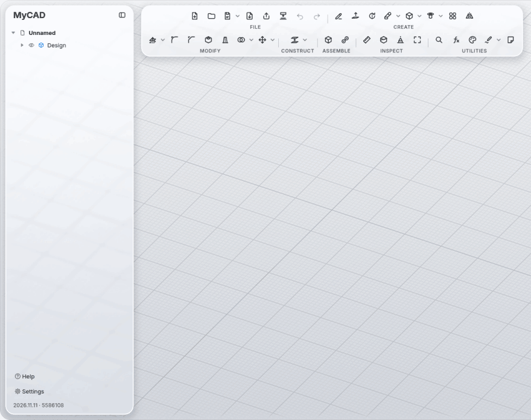
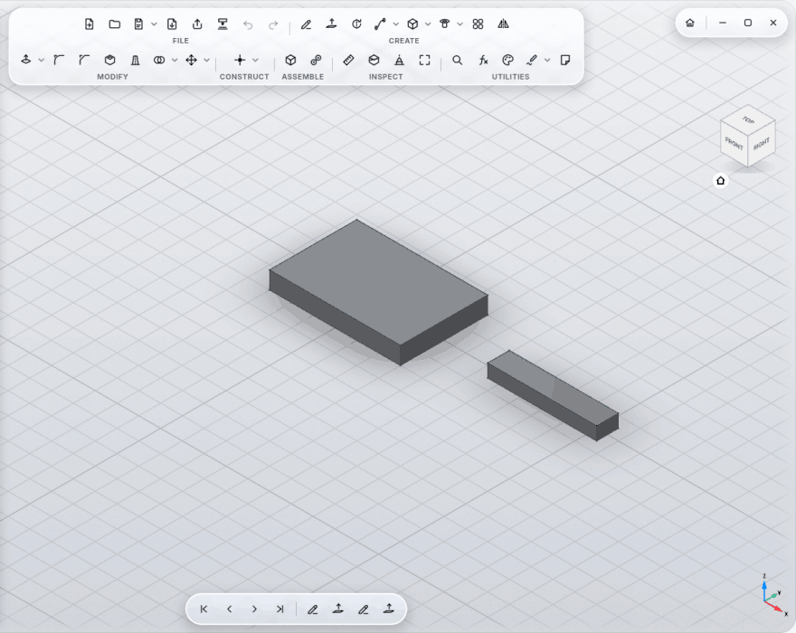
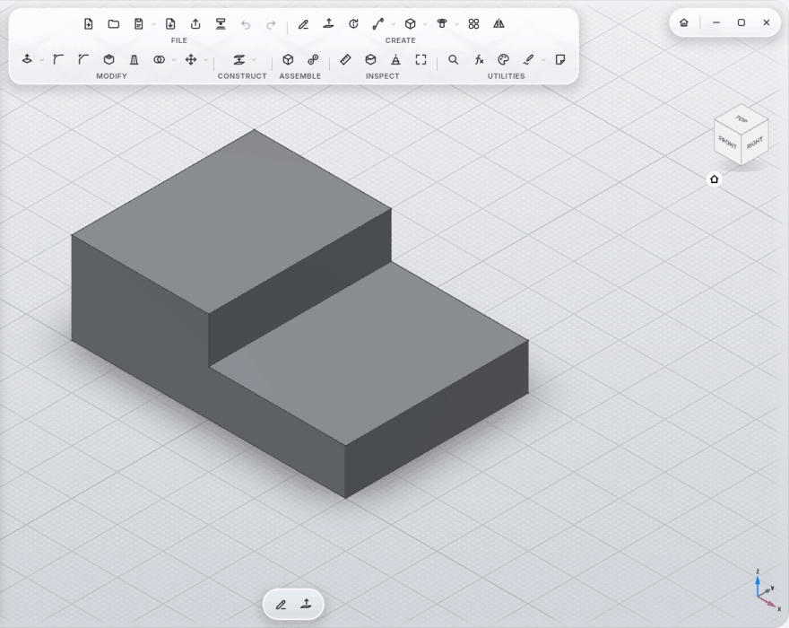

# Assemblies

A step-by-step example is in the [Tutorial: an assembly with joints](Tutorial-Assembly).

## Components

**New Component** (ASSEMBLE section) creates a component with its own origin, bodies and sketches. What you build goes
into the active component. Everything stays in one file. The design itself (the root) never moves.

## Joints

**Joint** (key **J**): first an element on the component that moves (face, edge, hole, point), then the place it should go
to. Two flat faces lie on each other; **Flip** turns that around.

| Type | Motion | Values |
|---|---|---|
| Rigid | none | angle and offset as a fixed position |
| Revolute | around the axis | Angle |
| Slider | along the axis | Offset |
| Cylindrical | turn and slide | Angle, Offset |
| Pin-Slot | turn and slide in the slot | Angle, Offset |
| Planar | slide and turn in the plane | Offset, Offset 2, Angle |
| Ball | turn in every direction | three angles (yaw, pitch, roll) |

- **Keep angle and distance within limits:** minimum and maximum for angle and travel.
- **Animate:** the joint swings between its limits.
- **Show collisions:** reports which parts touch while it moves.

  

## Chains

A part joined to a moving part moves along.

## Closed loops

When a component gets a **second joint** (the last link of a four-bar linkage back to the frame, say), the chain is
closed. Then a solver (OndselSolver, as in FreeCAD's Assembly workbench) works out all joints of the chain together:

- The **first joint** of the chain drives with its angle or travel, **rigid** joints stay rigid, and the others follow.
- Before closing the chain, turn the parts roughly the way it should sit. That picks the way it folds. A fully stretched
  chain is folded by MyCAD itself.
- **Limits** of the following joints are checked: if the mechanism would have to go past them, the joint says so.
- If joints contradict each other (two fixed positions for the same part), the joint shows an error.
- Every joint type works in closed loops, Pin-Slot included.

## Measure and material

**Measure** shows volume, **mass**, **material** and **center of mass** for a whole body. The material comes from the
**Appearance** (wood → wood, brushed aluminum → aluminum); choose it yourself under Appearance → Physical material and
it stays.

