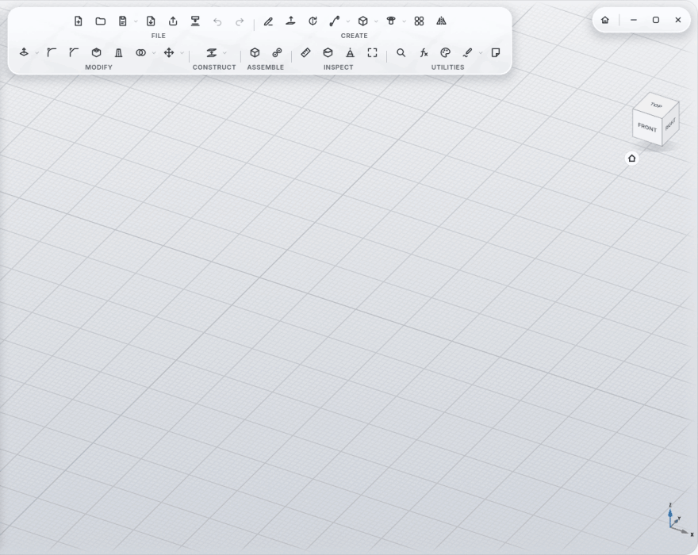
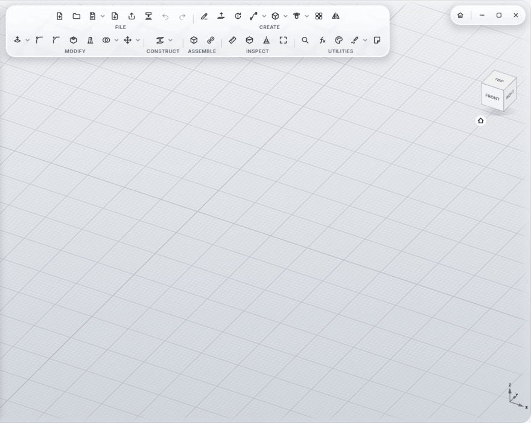
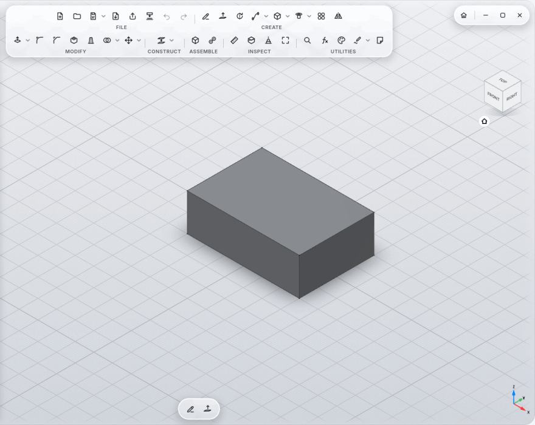
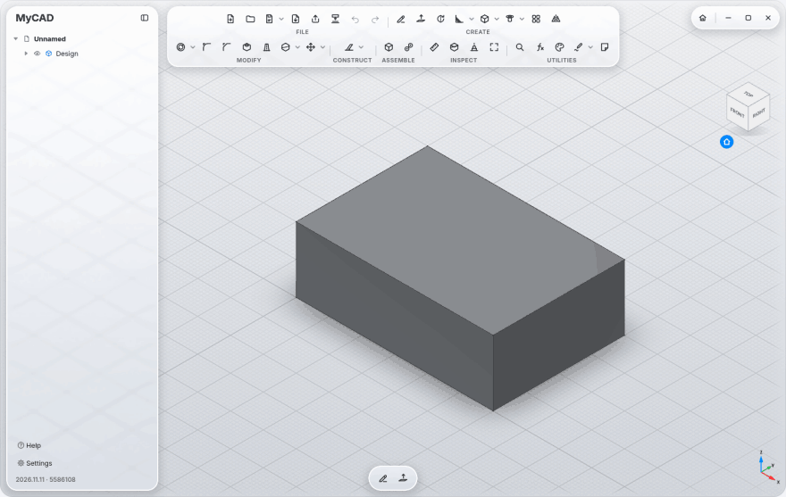
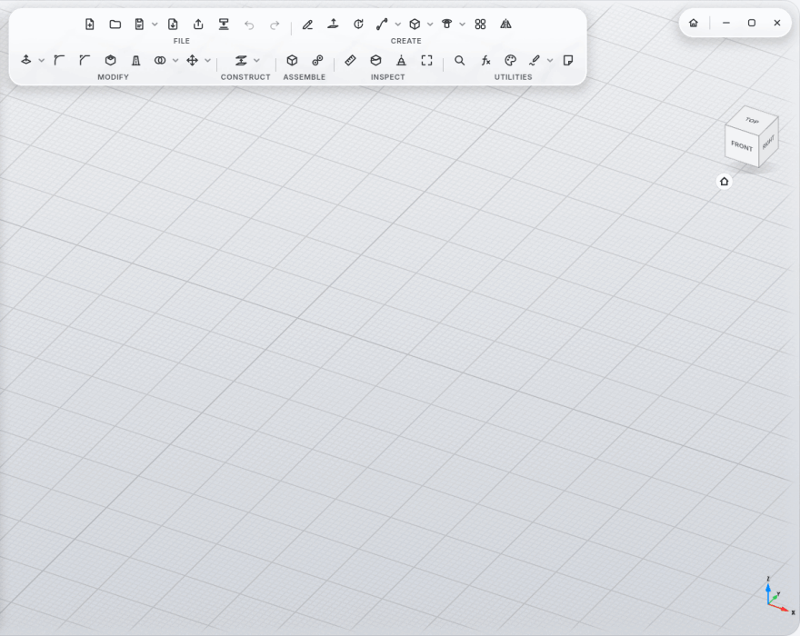
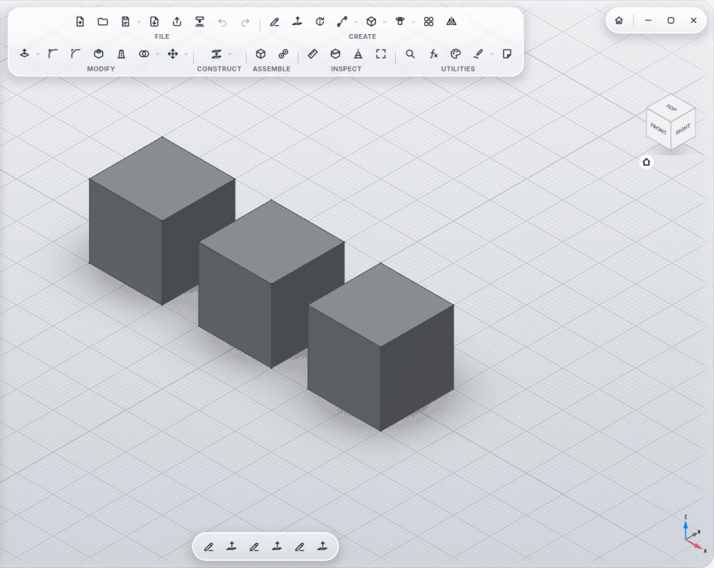
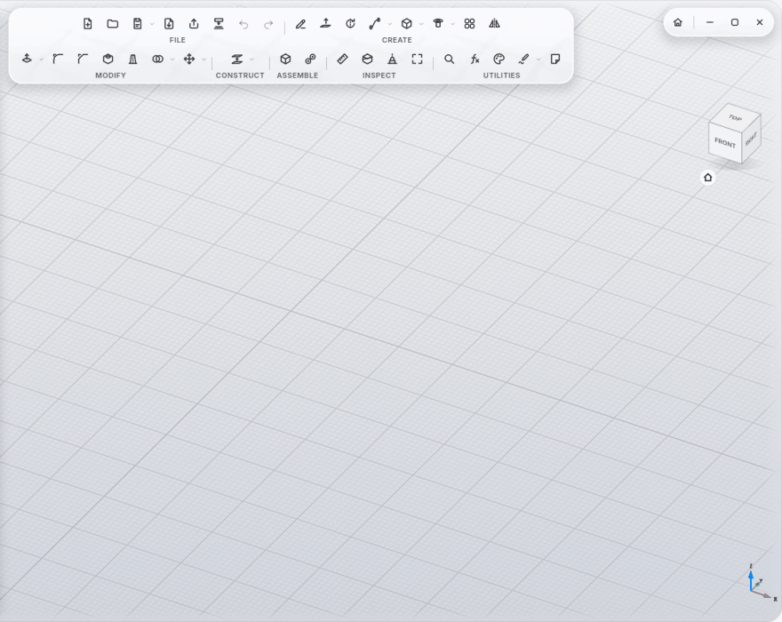
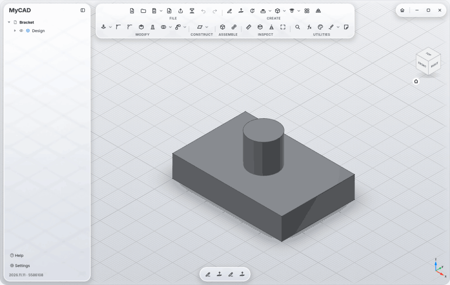
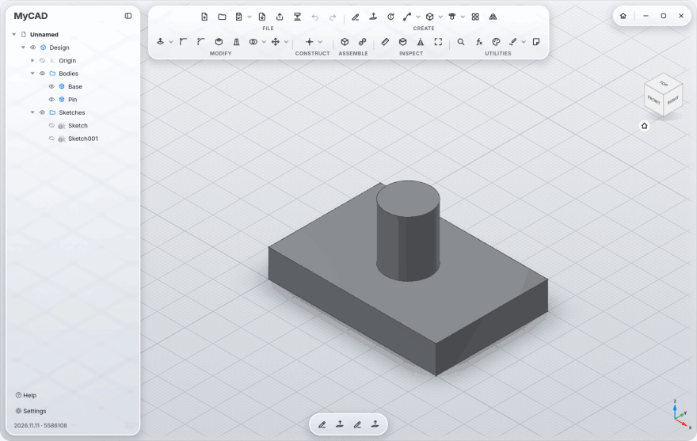
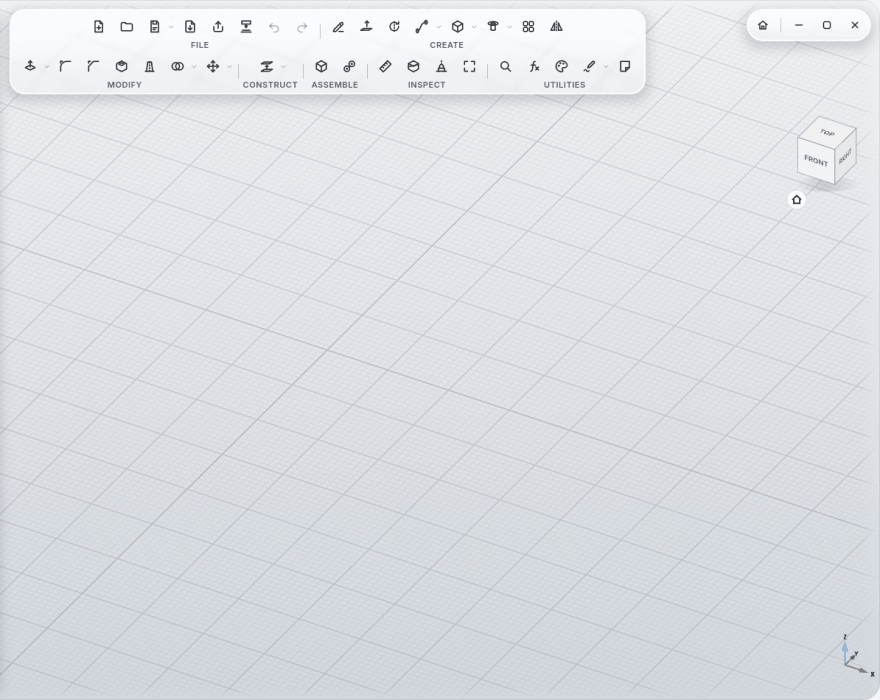

# Controls and Settings

## Keyboard shortcuts

| Key | What |
|---|---|
| **Ctrl+K** | command search: commands, bodies, sketches |
| **Ctrl+S** | Save Version (with a name) |
| **Ctrl+Z** / **Ctrl+Shift+Z** | Undo / Redo |
| **Ctrl+N** / **Ctrl+O** | New design / Open |
| **Ctrl+,** | Settings |
| **S** | Create Sketch |
| **E** | Extrude |
| **F** | Fillet |
| **H** | Hole |
| **Q** | Press Pull |
| **M** | Move |
| **J** | Joint |
| **A** | Appearance (material of the selected body) |
| **I** | Measure |
| **V, F** | Fit All: the whole model in view |
| **F1** | help for the tool under the mouse, or for the one you are using |
| **F2** | rename the entry selected in the browser |
| **Esc** | put the active tool away, leave a note or a scribble |
| **Delete** | delete the selection |

In a scribble:

| Key | What |
|---|---|
| **E** | eraser on/off |
| **V** | Select |
| **L** | Look At the sheet |
| **Tab** | Only the Sheet |
| **Delete** | delete the selected strokes |

## Navigation

Twelve navigation styles, including **Fusion 360**, **SolidWorks**, **Blender**, **Siemens NX** and **Touchpad**. For each
style, Settings shows which key or gesture orbits, pans, zooms and selects.

- Turn a key into a mouse button, e.g. **Shift** as the middle button, and navigate with your touchpad. Shift still works
  as Shift when you type.
- MyCAD orbits around the body under the cursor.
- **Show tool names** writes the names under the icons.
- The **view cube** at the top right turns to standard views; the house below it goes to the home view.

  

  

## Pen tablets

On Wayland, with pressure and hover. The side buttons orbit and pan, even while the tip is down. In KDE's **Drawing
Tablet** settings you can give the tablet's buttons keys: **E** eraser, **V** select, **L** look at the sheet, **Ctrl+Z**
undo.

## Settings

**Settings** at the bottom left (or **Ctrl+,**). Every number field there, and everywhere else, takes a decimal comma
too: `0,15` is `0.15`.

**Help** right above it (or **F1** over any tool) opens the built-in help: every tool with steps, options and a clip,
searchable in English and German.

**General**
- Color scheme Automatic / Light / Dark, **Liquid Glass** from Ultra Clear to Tinted, Show tool names, Show grid
- Language English / German
- **Materials and Light:** body material for new bodies (Steel unless you pick another); Lighting Studio (every face
  its own shade, best for modelling) or Room (soft, like a browser preview); Realistic materials, Reflections, Relief
  and end grain, Contact shadow
- Accessibility: Increase contrast, Reduce transparency, Reduce motion
- **Projects folder** (where new designs go)
- **3D printing:** Export resolution (coarse / normal / fine), 3D print clearance (tight / normal / loose, for Fit),
  Overhang angle and Minimum wall (for Print View)

**Navigation:** style, view options, rotation and zoom speed, trackpad gestures

**Keys:** keys as mouse buttons

**Pen & Handwriting:** how strongly handwriting is tidied up (or not at all)

## Materials

**Appearance** (UTILITIES section) has 119 materials: raw and polished metals, anodized aluminum, powder coat and lacquer,
matte to glossy plastics, PLA with print layers, rubber, glass, woods, stone, leather, felt, carbon. Many are real photo
scans with relief; wood shows end grain where it's cut.

- Click a sphere (applies to the selected bodies) or drag it onto a body; with single faces selected, only those change.
- Right-click to keep a favorite; the top shows what the design already uses.
- **Physical material** in the same panel: the density used by **Measure** (mass); otherwise it follows the appearance.

  

## Files

- Undo, Redo and **Save Version** sit in the FILE section of the toolbar.

  

- **Start page** (**Home** at the top right, next to the window buttons): recent designs and the projects folder, with
  previews and search. Right-click a design to **Rename** it (its project folder and versions follow) or **Delete** it
  (to the trash, after asking).

  

- **Browser** on the left: the eye in front of an entry shows or hides it, right-click for Show / Hide, Rename, Move,
  Export and Delete, **F2** renames. Click the design name at the top to rename the design, file and project folder
  included. **Saved** at the bottom right means the current state is on disk. Right-click the design name: Save Version,
  Save As, Export, **Variants**, Rename, Close, Delete (to the trash). Right-click an empty spot in the view for the
  tools you need most.

  
- **Insert:** STEP (one body per solid), DXF and SVG into a sketch.

  

- Format `.mycad` (a ZIP with a preview picture, the same content as `.FCStd`); `.FCStd` opens too.
