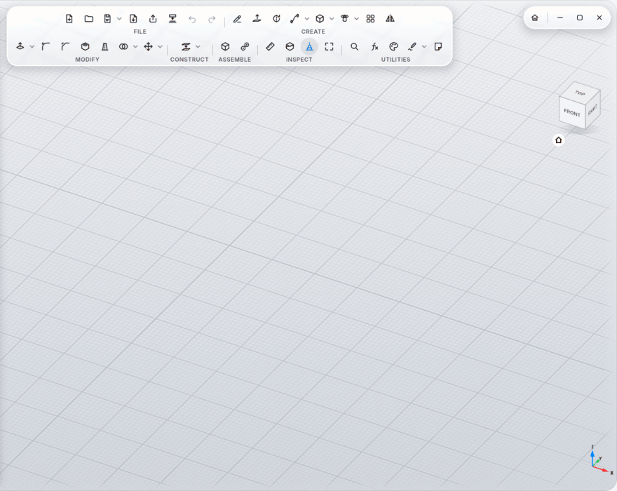

# MyCAD Wiki

MyCAD is Fusion-style CAD, native on Linux. Local, no subscription, made for 3D printing: the workflow of Fusion 360,
the look of Liquid Glass, and a handful of ideas you won't find in any other CAD program. It runs as an AppImage on
Arch-based systems, nothing to install; elsewhere you build it with one script until it's on Flathub.

Inside the app, the built-in help (**Help** at the bottom left, or **F1** over any tool) explains every tool step by step, in English or German,
depending on the language you picked. This wiki is the overview for everyone else.

## Where to start

| You want to … | Read |
|---|---|
| see everything MyCAD can do | **[Features](Features)**, all on one page |
| get going right away | **[Tutorial: a bracket for 3D printing](Tutorial-3D-Printed-Bracket)** (about 20 minutes) |
| start from a finished design | **New from Template** on the start page: box with lid, wall bracket, PCB enclosure, spacer, cable clip ([Features](Features#interface)) |
| switch from Fusion 360 | the help page **Switching from Fusion** (Getting Started): same names, the keys you know, what is different |
| connect parts that move | **[Tutorial: an assembly with joints](Tutorial-Assembly)** |
| look something up | the topic pages below |

## Topics

- [Modeling](Modeling): sketches, every tool, the timeline, sizes on the model, errors that explain themselves
- [Notes and Parameters](Notes-and-Parameters): calculate in a note and define parameters right there
- [Red Pen and Scribble](Red-Pen-and-Scribble): sketch ideas, handwriting, write corrections on the model
- [3D Printing](3D-Printing): Print View, orientation and splitting, your slicer, Printer Test, fits, Screw Here,
  hinges and snap hooks, print threads
- [Versions and Variants](Versions-and-Variants): always saved, nothing gets lost
- [Assemblies](Assemblies): components, joints, closed loops
- [Controls and Settings](Controls-and-Settings): navigation, shortcuts, pen tablets, language, materials
- [For Developers](For-Developers): build, test, how the code is organized

## What makes MyCAD different, in one minute

- **Always saved.** No save button, no question when you close. Every state becomes a version you can compare and
  bring back.
- **Double-click a face, change a number.** Double-click a face and the sizes that make it appear right on the model.
- **Your note is your parameter list.** `Wall = 2 mm` in a note is a parameter any size field can use.
- **Red Pen.** Write `R2` next to an edge, `M5` on a face, and MyCAD turns them into a fillet and a tapped hole.
- **Errors explain themselves.** A fillet too big? MyCAD tells you which radius fits and sets it in one click.
- **Tools for a purpose.** Screw Here joins two parts in one step; Fit makes a hole and its pin fit, to ISO or for
  your printer.
- **Printing in the viewport.** Overhangs, bed faces and thin walls on the model; Print opens your slicer.
- **Ctrl+K** finds every command, body and sketch, typos included, takes sentences like *4 holes M3 in the corners*
  and answers *Why is this red?*
- **Hardware included.** Screws, nuts, bearings and gears as real bodies, a parts list to order from.
