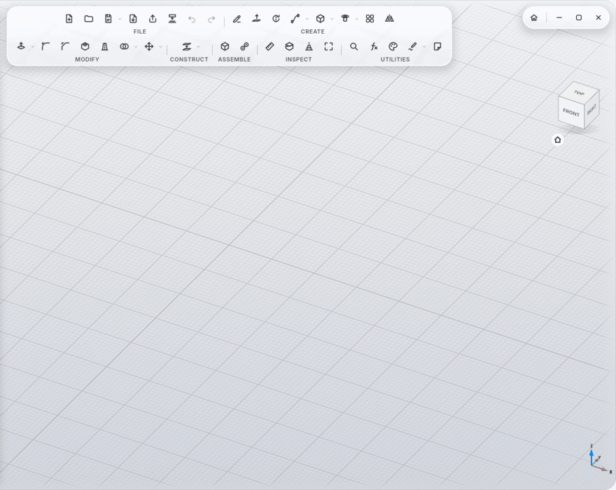
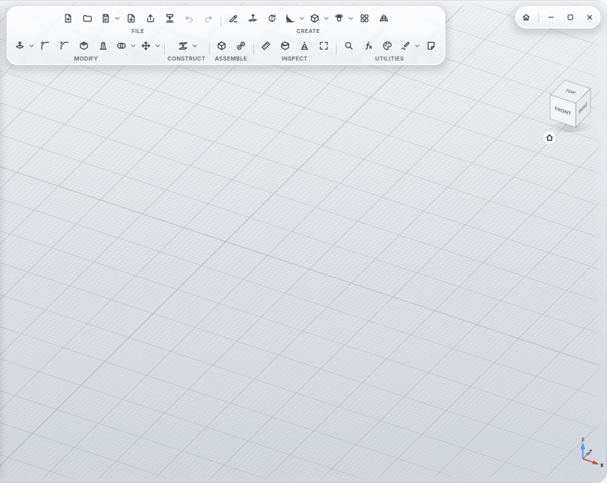

# Versions and Variants

## Always saved

MyCAD saves by itself: after every finished action, as soon as it rests for 2 seconds. Never in the middle of a tool
panel, while you drag, or during a camera animation.

- A **new design** gets its own folder in the projects folder the first time it's saved:
  `Projects/<Name>/<Name>.mycad`.
- **Closing** never asks about saving; the last seconds are saved quietly.
- **After a crash**, just open the design again: at most the last two seconds are missing.
- **Save As** on a design created this way takes its versions along, and the first folder goes to the trash.
- It can be turned off with the parameter `MyCAD/AlwaysSave` (meant for tests).

## Save Version (Ctrl+S)

Gives the current state a name, such as "Before the holes". Named versions are always kept.

## Versions

FILE section, arrow ▾ next to **Save Version** → **Versions**.

- Every saved state is a version, with a preview picture and time.
- **Kept like Time Machine:** everything from the last day, then one per hour for a week, then one per day. Named
  versions always stay.
- **Open Copy:** shows the version as its own design, without changing it.
- **Compare:** lays the version over the model as a ghost: **dotted green** was added since then, **hatched red** was
  removed, and the panel lists new, removed and changed steps.
- **Restore:** brings the state back. The state before stays as a version; restoring never deletes anything.

Versions are stored next to the design file in `versions/<Name>/`.

## Variants: "what if"

A variant is a copy of the design to try something out.

- **New Variant…** (in the Versions window): enter a name, and MyCAD switches into it right away.
- **Switch in the browser:** right-click the design name at the top of the browser → **Variants** → Main design or a
  variant (the open one has a check mark).
- **Compare** shows the difference between variant and main design, just like versions.
- **Make Main Design:** the open variant becomes the main design; the old one is kept as a version "Before …".

Variants are stored in `variants/<Name>/` next to the design file.
